# Sayphora — Product Walkthrough

Sayphora is a full-stack beauty shopping experience built around product discovery, informed buying decisions, customer accounts, order management and store operations. This visual tour shows how the storefront and staff console look and how the main customer journeys fit together.

**51 product screens · Customer and staff journeys · Desktop and mobile layouts**

## How the application works

The storefront is built with **React**, and it communicates with a **TypeScript/Express API**. **PostgreSQL** stores the application data. The backend is responsible for account and session rules, catalogue records, stock, pricing, promotions, orders, reviews, wishlists and loyalty activity. The storefront presents that data and sends actions to the API; it does not act as the final authority for prices, inventory or order state.

The screenshots use the application's seeded catalogue and example accounts so the full experience can be explored without exposing real customer information. Where an interaction changes application data—such as creating an order, changing inventory, saving a product or pausing a promotion—the related screens show the resulting application state.

## The product at a glance

- **Discover:** Browse the catalogue, search, filter, sort and compare product details.
- **Choose:** Explore ingredient information, shade matching, routines, bundles and virtual try-on.
- **Shop:** Register, save products, apply promotions, choose samples and gift options, then place and track an order.
- **Return:** Review loyalty points and redeem available rewards.
- **Operate:** Staff can manage products, inventory, orders, reviews and promotions through a protected console.

---

## 1. The storefront

The storefront is the starting point for the customer journey. Product listings lead into deeper product information, while search, filters and display preferences make the catalogue easier to explore.

<table>
<tr>
<td width="100%" valign="top">

<strong>THE STORE</strong>

<a href="screenshots/01-storefront-catalogue.png">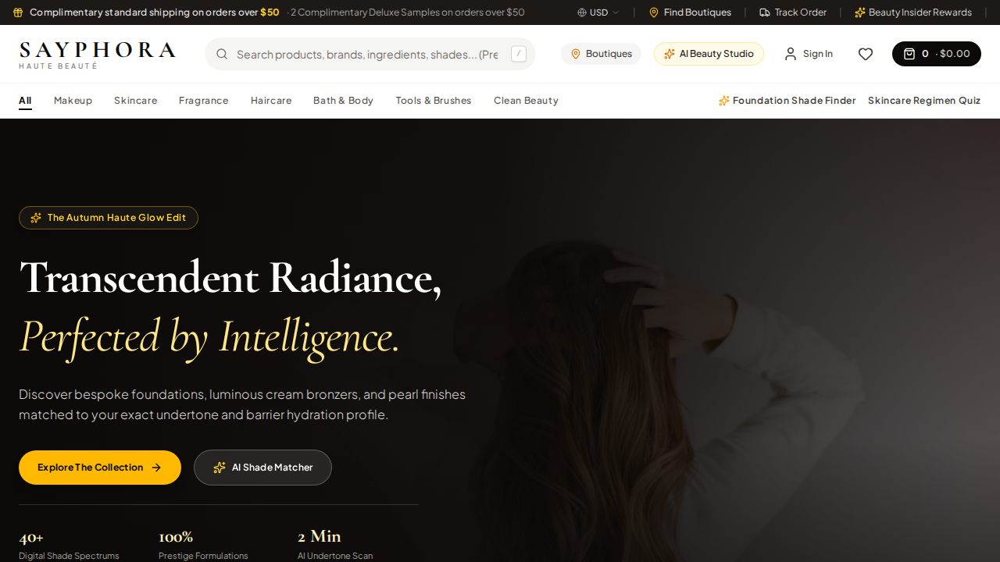</a>

<strong>Storefront catalogue</strong> The main storefront brings the beauty catalogue, product cards, prices and shopping entry points together. Desktop view · <a href="screenshots/01-storefront-catalogue.png">View full-size image</a>

</td>
</tr>
</table>

### Browse first, then narrow the catalogue

Search, catalogue filters and sorting help shoppers narrow the selection. The adjacent storefront preferences view shows currency display and newsletter sign-up.

<table>
<tr>
<td width="50%" valign="top">

<strong>DISCOVERY CONTROLS</strong>

<a href="screenshots/22-storefront-refinements.png">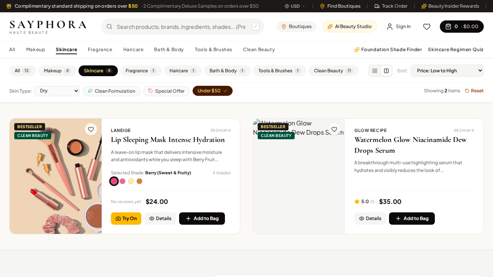</a>

<strong>Catalogue filtering, sorting and editorial view</strong> Search, filters, sorting and the alternate catalogue presentation help narrow product discovery. Desktop view · <a href="screenshots/22-storefront-refinements.png">View full-size image</a>

</td>
<td width="50%" valign="top">

<strong>STOREFRONT PREFERENCES</strong>

<a href="screenshots/23-newsletter-currency.png">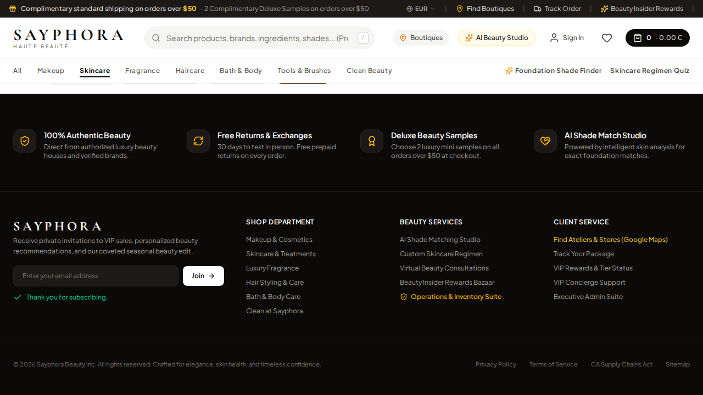</a>

<strong>Currency preference and newsletter confirmation</strong> The storefront includes a currency display preference and newsletter sign-up experience. Desktop view · <a href="screenshots/23-newsletter-currency.png">View full-size image</a>

</td>
</tr>
</table>

### Compare products and inspect the details

The comparison matrix helps evaluate product attributes together, while the image viewer provides a closer look at product imagery.

<table>
<tr>
<td width="50%" valign="top">

<strong>SIDE-BY-SIDE COMPARISON</strong>

<a href="screenshots/14-product-comparison.png">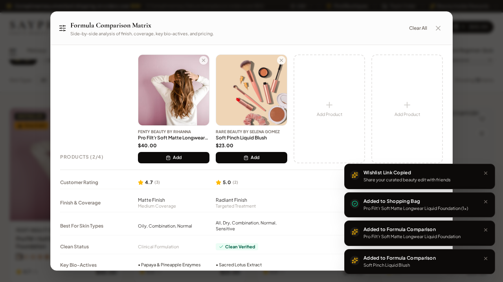</a>

<strong>Side-by-side product comparison</strong> The comparison matrix places product attributes side by side to support a more informed choice. Desktop view · <a href="screenshots/14-product-comparison.png">View full-size image</a>

</td>
<td width="50%" valign="top">

<strong>PRODUCT IMAGE VIEW</strong>

<a href="screenshots/24-product-gallery-lightbox.png">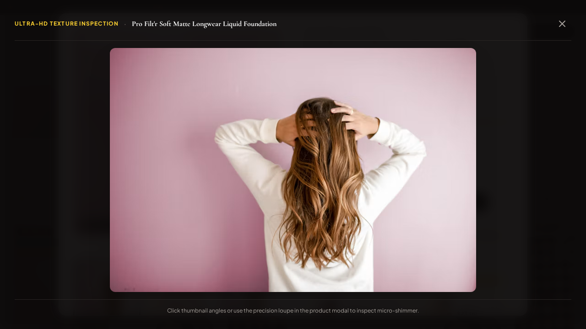</a>

<strong>Product image lightbox</strong> The image viewer opens product imagery in a larger inspection view. Desktop view · <a href="screenshots/24-product-gallery-lightbox.png">View full-size image</a>

</td>
</tr>
</table>

## 2. Account and shopping bag

Customers can create an account, build a bag, apply a promotion and adjust their selection. The views below make the result of each action visible.

### Create an account

After the registration form is submitted successfully, the customer moves into the shopping experience.

<table>
<tr>
<td width="50%" valign="top">

<strong>BEFORE · REGISTRATION</strong>

<a href="screenshots/02-registration-form.png">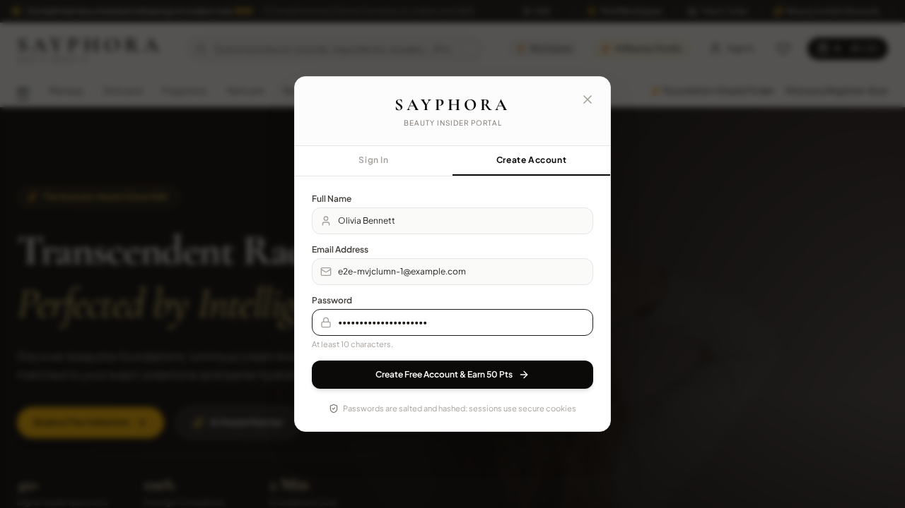</a>

<strong>Registration form</strong> A new customer enters the details needed to create an account. Desktop view · <a href="screenshots/02-registration-form.png">View full-size image</a>

</td>
<td width="50%" valign="top">

<strong>AFTER · ACCOUNT READY</strong>

<a href="screenshots/03-registration-success.png">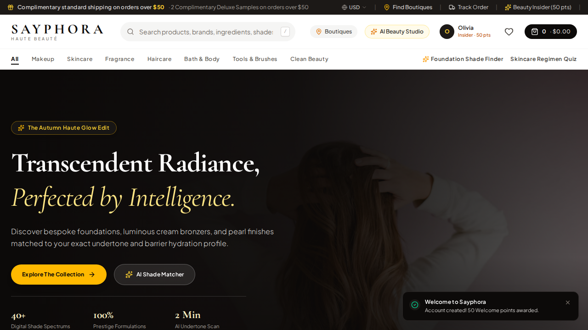</a>

<strong>Account created</strong> After registration, the customer reaches the shopping experience in an authenticated state. Desktop view · <a href="screenshots/03-registration-success.png">View full-size image</a>

</td>
</tr>
</table>

### Apply a promotion

The bag moves from a selected product to a state where the accepted promotion is reflected in the order summary.

<table>
<tr>
<td width="50%" valign="top">

<strong>BEFORE · BAG</strong>

<a href="screenshots/04-shopping-bag.png">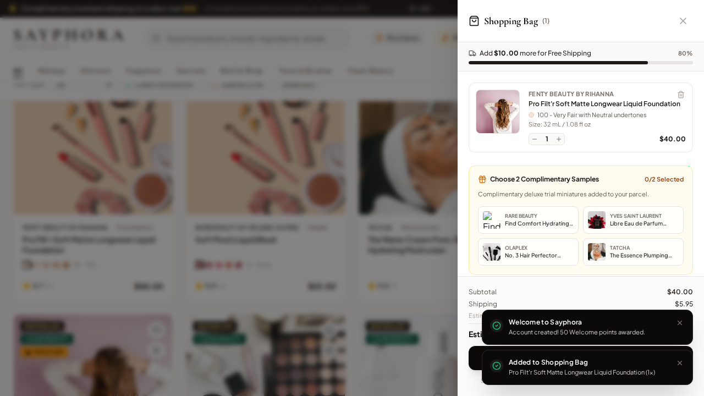</a>

<strong>Product added to the bag</strong> The bag shows the selected product and the next step toward checkout. Desktop view · <a href="screenshots/04-shopping-bag.png">View full-size image</a>

</td>
<td width="50%" valign="top">

<strong>AFTER · PROMOTION APPLIED</strong>

<strong>Promotion accepted</strong> An accepted promotion is reflected in the bag alongside the order value. Desktop view · <a href="screenshots/05-promotion-applied.png">View full-size image</a>

</td>
</tr>
</table>

### Adjust the bag, then reach the empty state

Quantity, complimentary samples and an applied promotion are presented together. Removing the final item gives the customer a clear empty-bag state.

<table>
<tr>
<td width="50%" valign="top">

<strong>BEFORE · ITEMS, SAMPLES AND PROMO</strong>

<a href="screenshots/41-cart-samples-promo.png">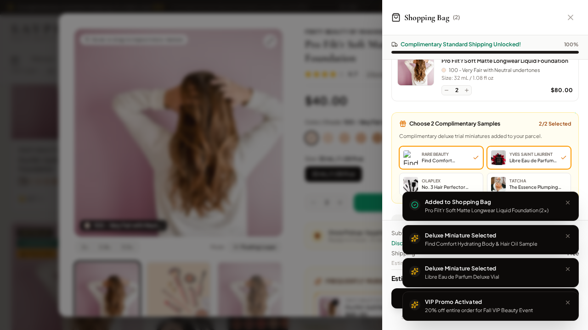</a>

<strong>Cart quantity, samples and promotion</strong> The bag shows quantity changes, complimentary samples and an applied promotion together. Desktop view · <a href="screenshots/41-cart-samples-promo.png">View full-size image</a>

</td>
<td width="50%" valign="top">

<strong>AFTER · EMPTY BAG</strong>

<strong>Empty bag after removing the item</strong> Removing the final item leaves a clear empty-bag state. Desktop view · <a href="screenshots/42-cart-empty-state.png">View full-size image</a>

</td>
</tr>
</table>

### Save a wishlist and share it

The wishlist keeps a selected product for later and exposes a share action for the saved selection.

<table>
<tr>
<td width="50%" valign="top">

<strong>BEFORE · SAVED PRODUCTS</strong>

<a href="screenshots/13-saved-wishlist.png">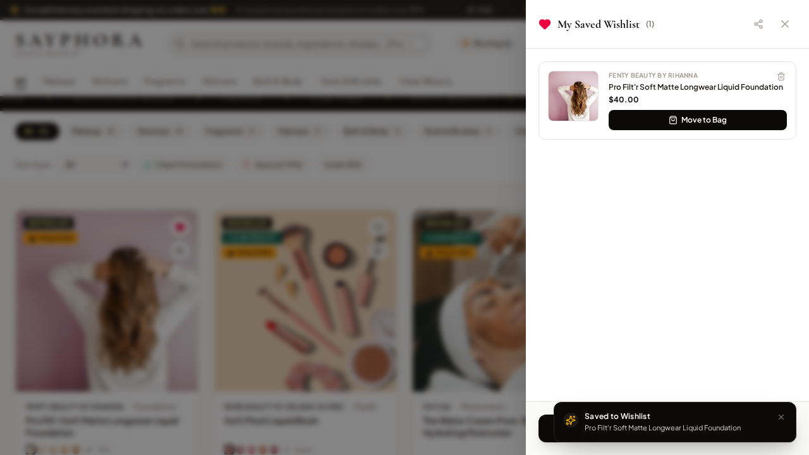</a>

<strong>Saved wishlist</strong> A saved product is kept in the customer's wishlist for later. Desktop view · <a href="screenshots/13-saved-wishlist.png">View full-size image</a>

</td>
<td width="50%" valign="top">

<strong>AFTER · SHARE ACTION</strong>

<a href="screenshots/40-wishlist-share-link.png">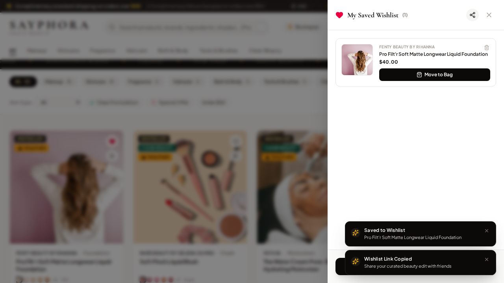</a>

<strong>Shareable wishlist link</strong> The wishlist sharing action provides a link to share the saved selection. Desktop view · <a href="screenshots/40-wishlist-share-link.png">View full-size image</a>

</td>
</tr>
</table>

## 3. Product and beauty tools

Product pages bring together purchase choices and helpful context. Sayphora also includes comparison, bundles, virtual try-on, ingredient information, shade matching and routine guidance.

### Product details and customer feedback

A product page leads into customer reviews. The review experience displays verified-purchase context and lets shoppers focus on verified feedback and mark a review helpful.

<table>
<tr>
<td width="33.333333333333336%" valign="top">

<strong>PRODUCT DETAIL</strong>

<a href="screenshots/09-product-detail.png">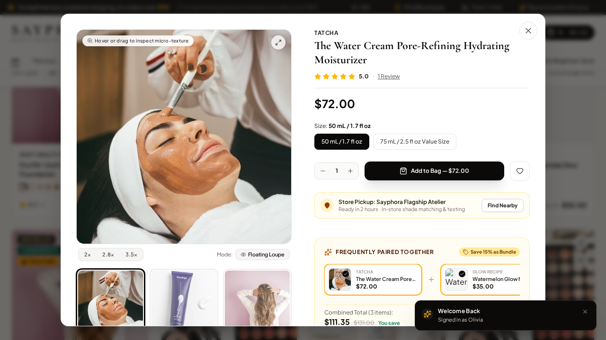</a>

<strong>Product details</strong> Product detail keeps the key purchase information and review entry point close to the product. Desktop view · <a href="screenshots/09-product-detail.png">View full-size image</a>

</td>
<td width="33.333333333333336%" valign="top">

<strong>VERIFIED-PURCHASE REVIEW</strong>

<a href="screenshots/10-verified-product-review.png">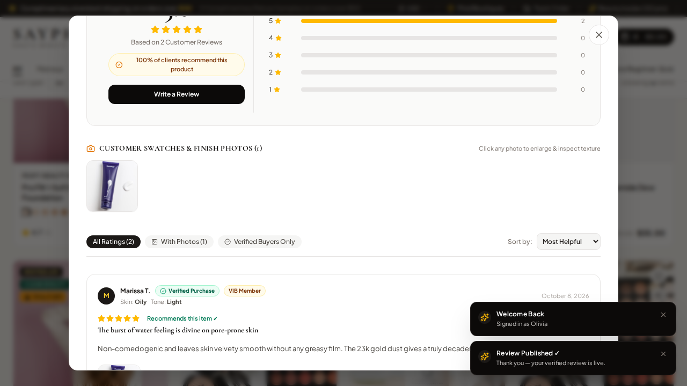</a>

<strong>Verified purchase review</strong> A customer review is shown with its verified-purchase context. Desktop view · <a href="screenshots/10-verified-product-review.png">View full-size image</a>

</td>
<td width="33.333333333333336%" valign="top">

<strong>REVIEW FILTER AND VOTE</strong>

<a href="screenshots/44-review-vote-filter.png">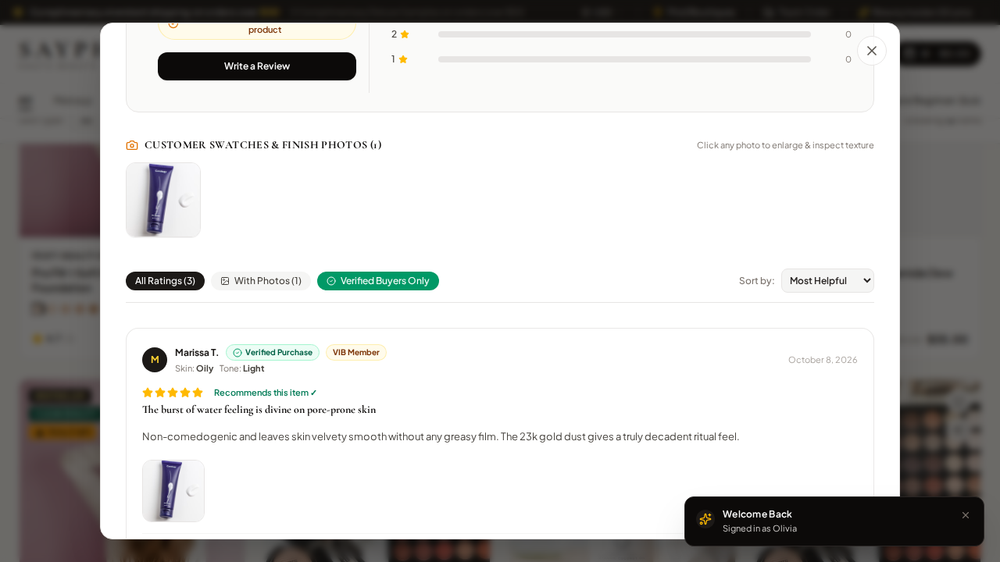</a>

<strong>Verified review filter and helpful voting</strong> Customers can focus on verified-purchase reviews and mark helpful feedback. Desktop view · <a href="screenshots/44-review-vote-filter.png">View full-size image</a>

</td>
</tr>
</table>

### Explore a foundation finish, then add it to the bag

The selected foundation finish carries from the virtual try-on screen into the shopping bag.

<table>
<tr>
<td width="50%" valign="top">

<strong>BEFORE · VIRTUAL TRY-ON</strong>

<a href="screenshots/15-virtual-try-on.png">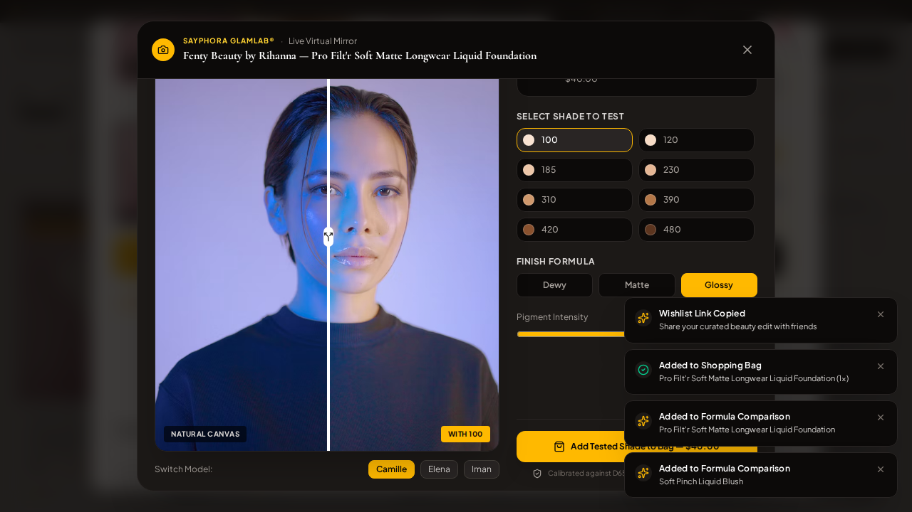</a>

<strong>Virtual try-on studio</strong> The virtual try-on screen lets a shopper explore a foundation finish. Desktop view · <a href="screenshots/15-virtual-try-on.png">View full-size image</a>

</td>
<td width="50%" valign="top">

<strong>AFTER · PRODUCT IN BAG</strong>

<a href="screenshots/16-vto-shade-added-to-bag.png">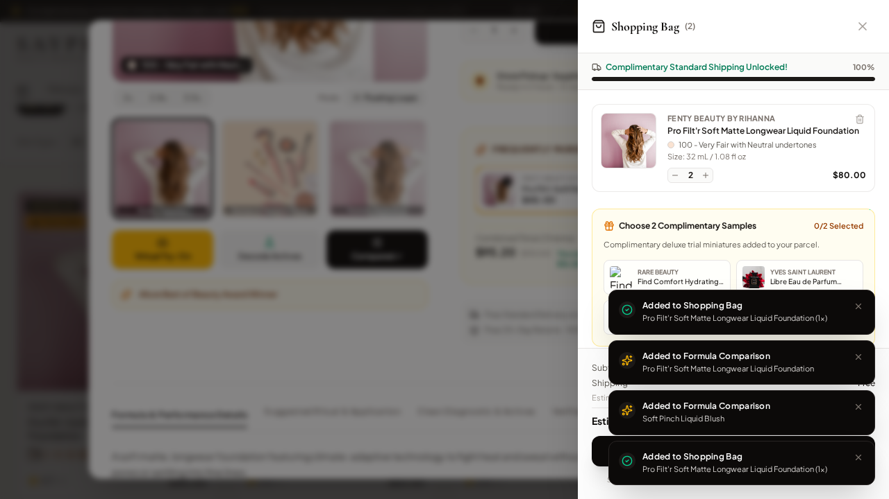</a>

<strong>Try-on shade added to the bag</strong> The selected foundation carries from the try-on journey into the shopping bag. Desktop view · <a href="screenshots/16-vto-shade-added-to-bag.png">View full-size image</a>

</td>
</tr>
</table>

### Build a bundle or choose a product size

Complementary items can be grouped as a bundle. Product detail also exposes size and quantity choices along with the item's application routine.

<table>
<tr>
<td width="50%" valign="top">

<strong>BUNDLE BUILDER</strong>

<a href="screenshots/25-product-bundle-builder.png">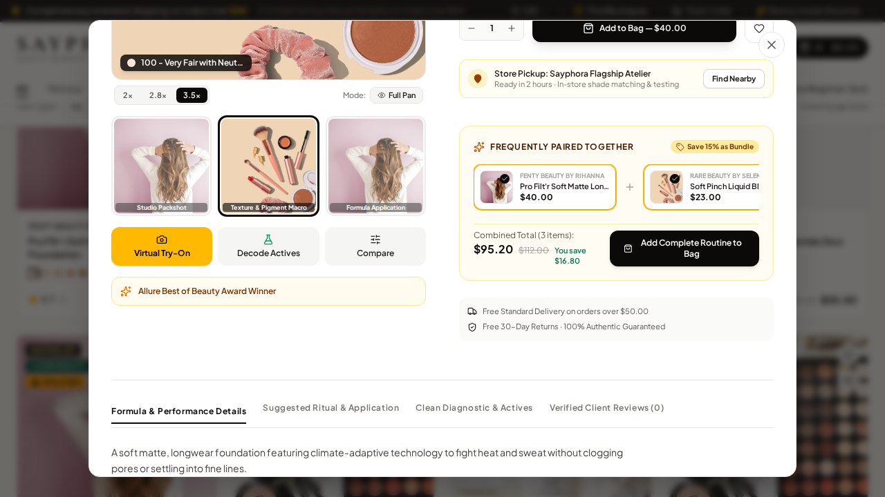</a>

<strong>Curated product bundle</strong> The bundle builder groups complementary products and displays the bundle saving. Desktop view · <a href="screenshots/25-product-bundle-builder.png">View full-size image</a>

</td>
<td width="50%" valign="top">

<strong>SIZE AND APPLICATION ROUTINE</strong>

<a href="screenshots/43-product-size-and-ritual.png">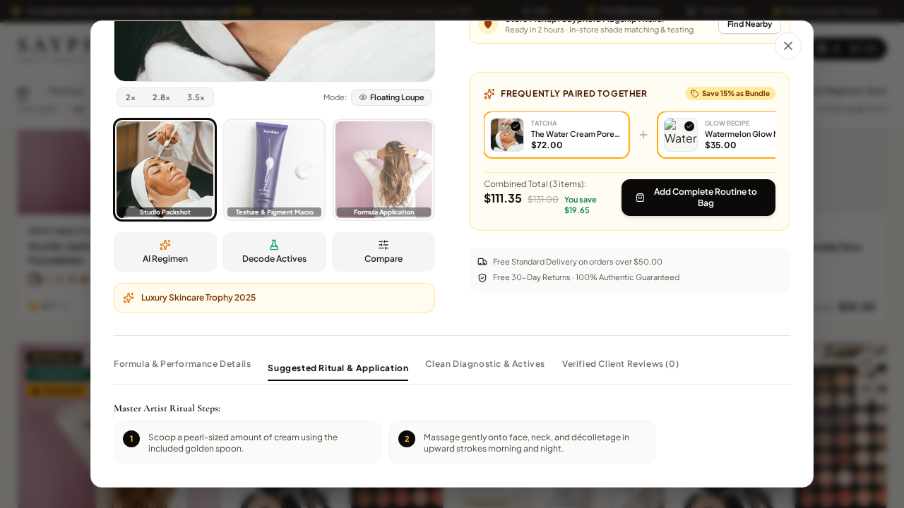</a>

<strong>Product size, quantity and application routine</strong> Product detail exposes size and quantity selections alongside the item's application routine. Desktop view · <a href="screenshots/43-product-size-and-ritual.png">View full-size image</a>

</td>
</tr>
</table>

### Explore formulation details and personalised guidance

The ingredient view presents formulation information, while the shade experience suggests an in-catalogue choice based on the selected profile.

<table>
<tr>
<td width="50%" valign="top">

<strong>INGREDIENT INFORMATION</strong>

<a href="screenshots/17-ingredient-diagnostics.png">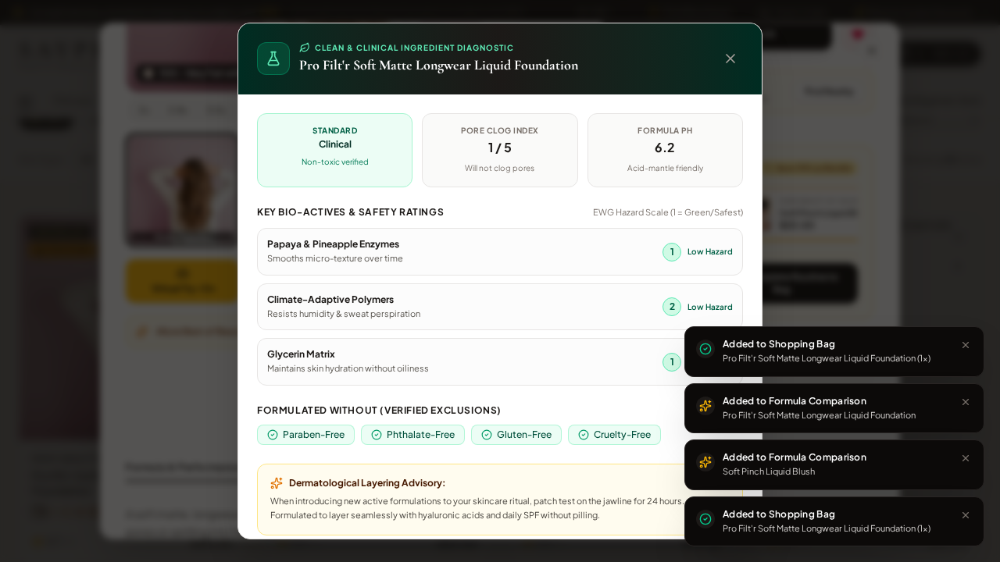</a>

<strong>Ingredient safety diagnostic</strong> The ingredient view presents formulation details and the product's available diagnostic information. Desktop view · <a href="screenshots/17-ingredient-diagnostics.png">View full-size image</a>

</td>
<td width="50%" valign="top">

<strong>SHADE MATCH</strong>

<a href="screenshots/18-shade-match.png">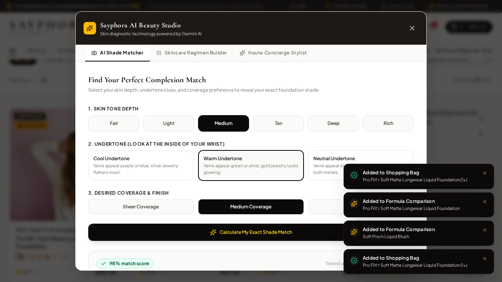</a>

<strong>Personalised shade match</strong> The shade-matching experience suggests an in-catalogue option from the selected profile. Desktop view · <a href="screenshots/18-shade-match.png">View full-size image</a>

</td>
</tr>
</table>

### Build a routine and ask the beauty concierge

The routine builder separates morning and evening steps. The concierge offers catalogue-aware product guidance; live AI-provider answers depend on optional provider configuration.

<table>
<tr>
<td width="50%" valign="top">

<strong>AM/PM ROUTINE</strong>

<a href="screenshots/19-skincare-routine.png">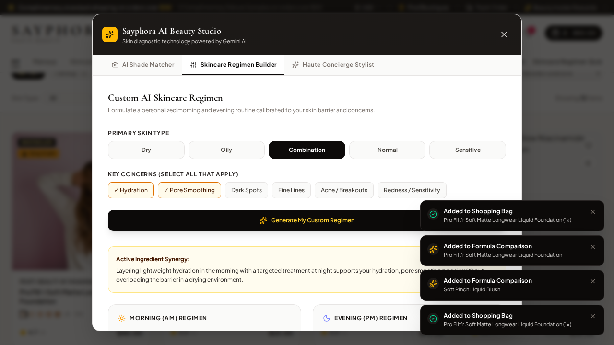</a>

<strong>Morning and evening routine</strong> The routine builder separates recommended steps into morning and evening care. Desktop view · <a href="screenshots/19-skincare-routine.png">View full-size image</a>

</td>
<td width="50%" valign="top">

<strong>BEAUTY CONCIERGE</strong>

<a href="screenshots/30-ai-concierge.png">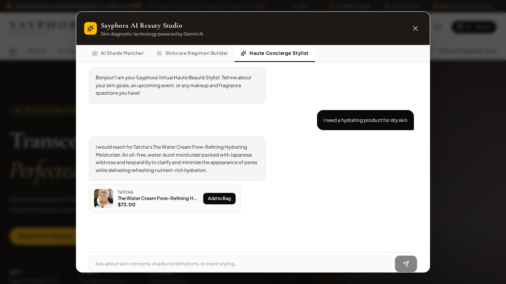</a>

<strong>Concierge product recommendation</strong> The beauty concierge connects a shopper's question to catalogue-aware product guidance. Desktop view · <a href="screenshots/30-ai-concierge.png">View full-size image</a>

</td>
</tr>
</table>

## 4. Checkout and order journey

Checkout collects the order details before the order is created. Afterwards, customers can open their order and follow its in-app status.

### From checkout review to order tracking

The customer reviews the order, receives an order reference, and can return to the tracking view to see its current progress.

<table>
<tr>
<td width="33.333333333333336%" valign="top">

<strong>01 · REVIEW ORDER</strong>

<a href="screenshots/06-checkout-review.png">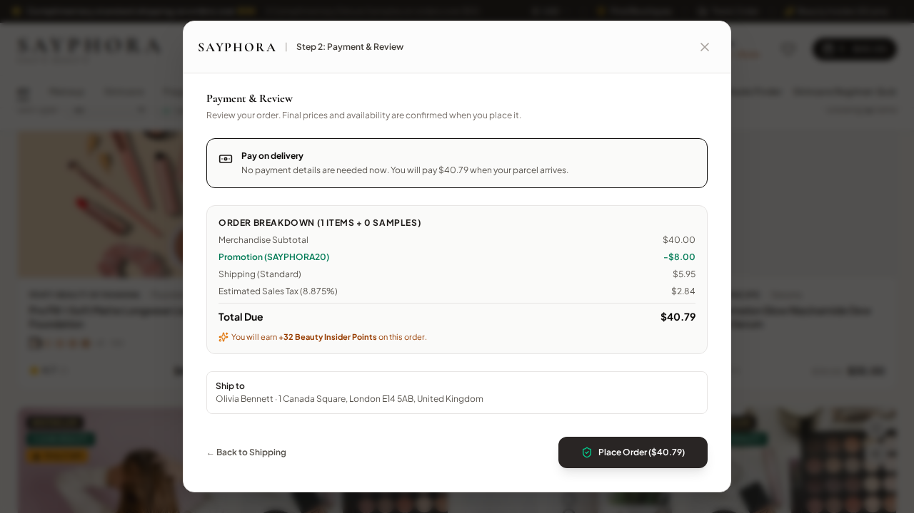</a>

<strong>Checkout review</strong> The checkout review brings the selected items, delivery details and payable total into one place. Desktop view · <a href="screenshots/06-checkout-review.png">View full-size image</a>

</td>
<td width="33.333333333333336%" valign="top">

<strong>02 · ORDER CONFIRMED</strong>

<a href="screenshots/07-order-confirmation.png">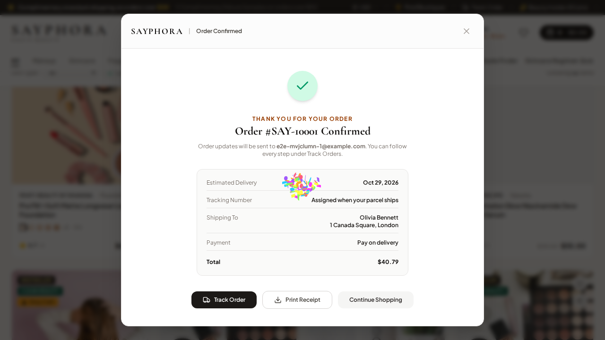</a>

<strong>Order confirmation</strong> The completed order is shown with its order reference and confirmation details. Desktop view · <a href="screenshots/07-order-confirmation.png">View full-size image</a>

</td>
<td width="33.333333333333336%" valign="top">

<strong>03 · TRACK ORDER</strong>

<a href="screenshots/08-order-tracking.png">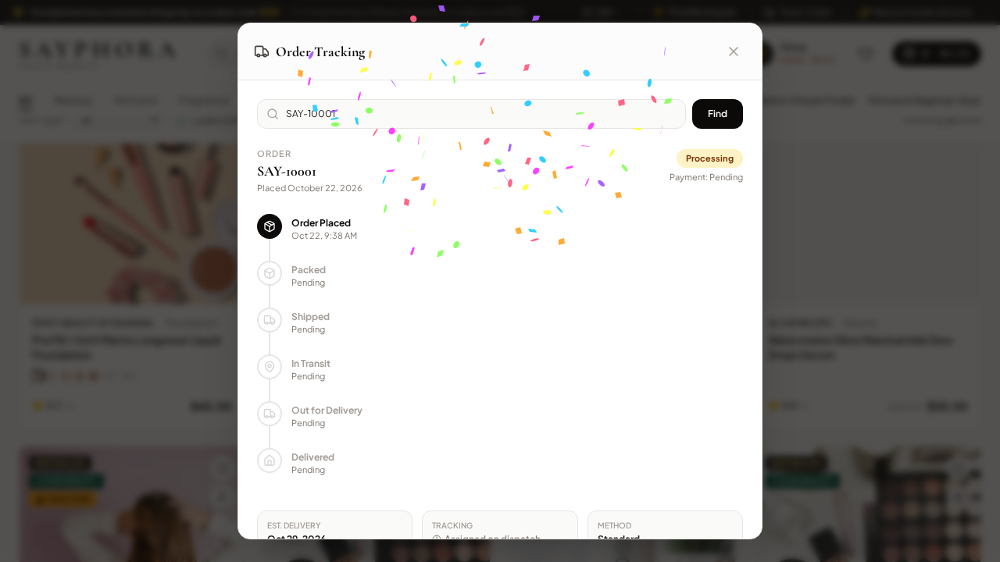</a>

<strong>Order tracking</strong> The customer can revisit an order and see its current in-app progress. Desktop view · <a href="screenshots/08-order-tracking.png">View full-size image</a>

</td>
</tr>
</table>

### Choose gift options and review the final order

Delivery speed, address saving and gift presentation are carried into the review step.

<table>
<tr>
<td width="50%" valign="top">

<strong>BEFORE · DELIVERY AND GIFT OPTIONS</strong>

<a href="screenshots/26-checkout-gift-options.png">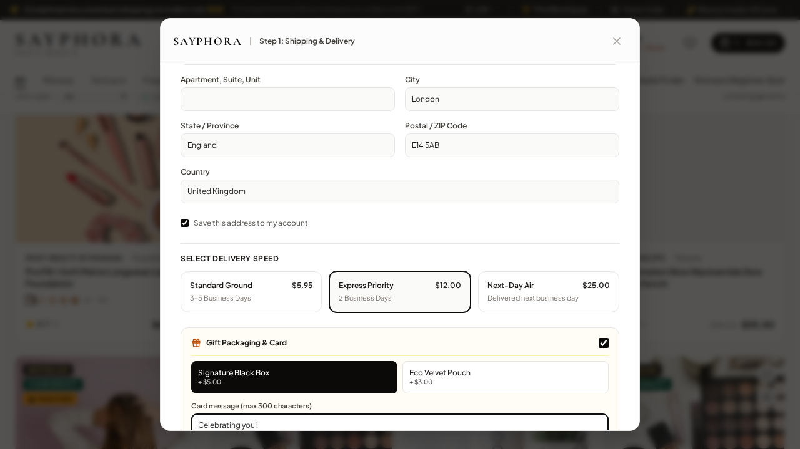</a>

<strong>Express delivery and gift options</strong> Delivery speed, saved address and gift presentation can be configured before the final review. Desktop view · <a href="screenshots/26-checkout-gift-options.png">View full-size image</a>

</td>
<td width="50%" valign="top">

<strong>AFTER · ORDER REVIEW</strong>

<a href="screenshots/27-checkout-gift-review.png">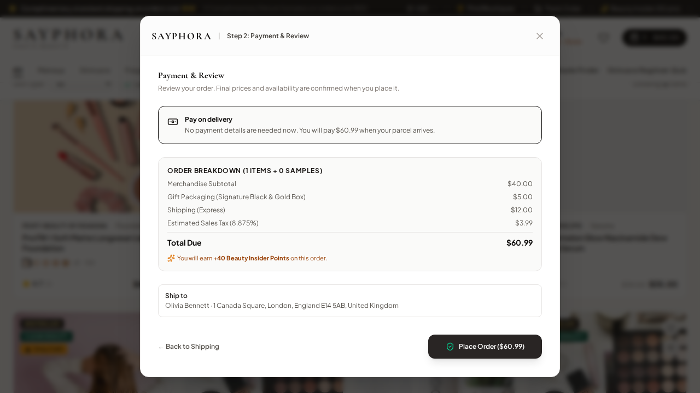</a>

<strong>Checkout review with gift packaging</strong> Checkout review carries the chosen delivery and gift details forward. Desktop view · <a href="screenshots/27-checkout-gift-review.png">View full-size image</a>

</td>
</tr>
</table>

### Use the experience on mobile

The mobile order view shows the customer's cancellation state, while the responsive navigation keeps primary storefront sections accessible on a narrow screen.

<table>
<tr>
<td width="50%" valign="top">

<strong>CUSTOMER ORDER ACTION</strong>

<a href="screenshots/45-customer-order-cancelled.png">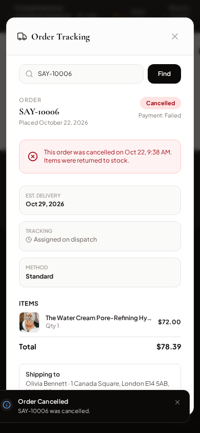</a>

<strong>Order lookup and eligible cancellation</strong> The customer can look up an eligible order and see the cancellation state. Mobile view · <a href="screenshots/45-customer-order-cancelled.png">View full-size image</a>

</td>
<td width="50%" valign="top">

<strong>COMPACT NAVIGATION</strong>

<a href="screenshots/46-mobile-navigation.png">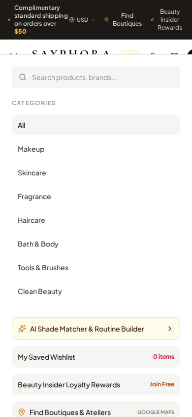</a>

<strong>Mobile navigation drawer</strong> The compact mobile navigation keeps key storefront areas reachable on a narrow screen. Mobile view · <a href="screenshots/46-mobile-navigation.png">View full-size image</a>

</td>
</tr>
</table>

## 5. Loyalty, boutique and installation experience

The experience extends beyond the initial purchase with reward redemption, pickup location selection and progressive-web-app features.

### Redeem loyalty points

The member sees their points and eligible rewards, then receives a reward code after redemption.

<table>
<tr>
<td width="50%" valign="top">

<strong>BEFORE · AVAILABLE REWARDS</strong>

<a href="screenshots/28-loyalty-bazaar.png">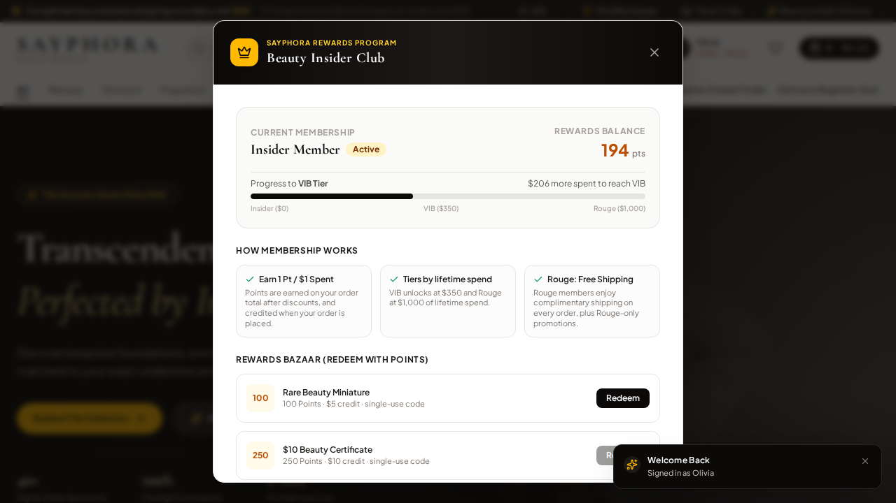</a>

<strong>Member rewards bazaar</strong> The loyalty area shows the member's points and available rewards. Desktop view · <a href="screenshots/28-loyalty-bazaar.png">View full-size image</a>

</td>
<td width="50%" valign="top">

<strong>AFTER · REWARD CODE</strong>

<a href="screenshots/29-loyalty-redemption.png">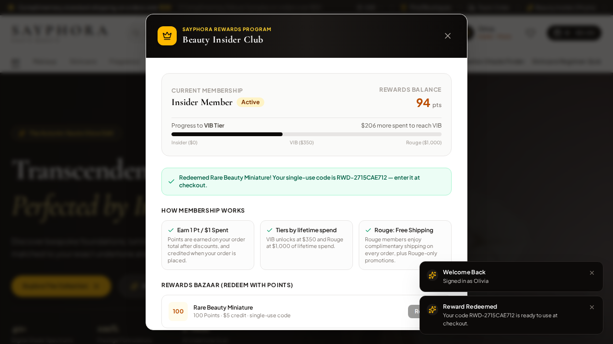</a>

<strong>Reward code issued</strong> Redeeming a reward presents a customer-facing reward code and updated points balance. Desktop view · <a href="screenshots/29-loyalty-redemption.png">View full-size image</a>

</td>
</tr>
</table>

### Select a pickup location

The directory presents the available boutiques and marks the selected pickup location.

<table>
<tr>
<td width="50%" valign="top">

<strong>BEFORE · BOUTIQUE DIRECTORY</strong>

<a href="screenshots/20-boutique-directory.png">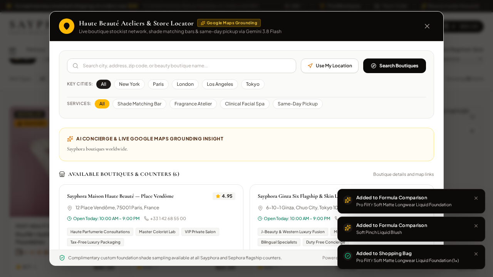</a>

<strong>Boutique directory</strong> The boutique directory presents available store locations and pickup choices. Desktop view · <a href="screenshots/20-boutique-directory.png">View full-size image</a>

</td>
<td width="50%" valign="top">

<strong>AFTER · PICKUP SELECTED</strong>

<a href="screenshots/21-pickup-store-selected.png">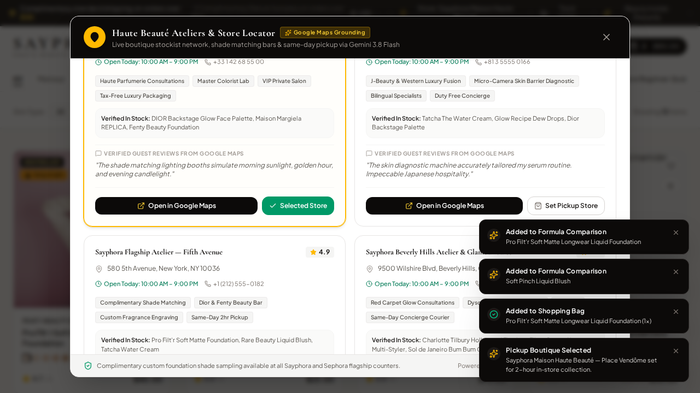</a>

<strong>Pickup location selected</strong> The chosen boutique is marked as the preferred pickup location. Desktop view · <a href="screenshots/21-pickup-store-selected.png">View full-size image</a>

</td>
</tr>
</table>

### Use the catalogue offline and view install guidance

Previously cached catalogue content can remain available offline. The install-help view explains the iOS add-to-home-screen steps.

<table>
<tr>
<td width="50%" valign="top">

<strong>OFFLINE CATALOGUE</strong>

<a href="screenshots/31-pwa-offline-catalog.png">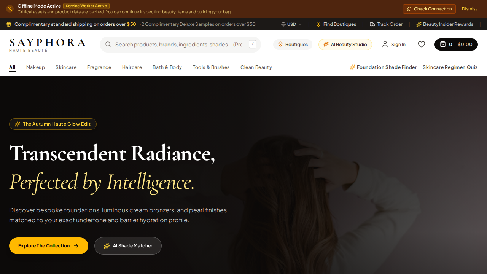</a>

<strong>Cached product catalogue while offline</strong> Previously cached catalogue content remains available in the supported offline experience. Desktop view · <a href="screenshots/31-pwa-offline-catalog.png">View full-size image</a>

</td>
<td width="50%" valign="top">

<strong>IOS INSTALL GUIDANCE</strong>

<a href="screenshots/47-ios-install-guide.png">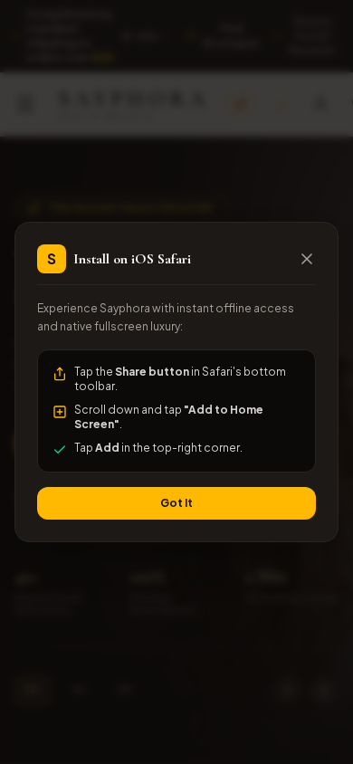</a>

<strong>iOS add-to-home-screen instructions</strong> The install-help panel explains the add-to-home-screen flow for iOS Safari. Mobile view · <a href="screenshots/47-ios-install-guide.png">View full-size image</a>

</td>
</tr>
</table>

## 6. Staff console

The protected staff console supports day-to-day catalogue and store operations. It includes an overview, product creation, inventory editing, order fulfilment, review moderation, and promotion management.

### Operations overview and service settings

Staff can view an operations summary and reach the configuration/diagnostics surfaces for the optional AI, location and PWA experiences.

<table>
<tr>
<td width="50%" valign="top">

<strong>STAFF OVERVIEW</strong>

<a href="screenshots/32-admin-overview.png">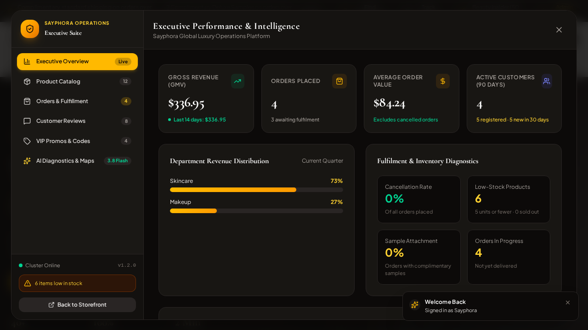</a>

<strong>Staff executive overview</strong> The staff console brings operational overview information together behind staff access. Desktop view · <a href="screenshots/32-admin-overview.png">View full-size image</a>

</td>
<td width="50%" valign="top">

<strong>AI, LOCATION AND PWA SETTINGS</strong>

<a href="screenshots/39-admin-ai-maps-pwa.png">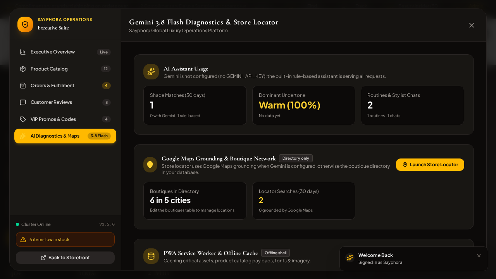</a>

<strong>AI, Maps and PWA diagnostics</strong> The operations area groups the configuration and status surfaces for AI, location and PWA features. Desktop view · <a href="screenshots/39-admin-ai-maps-pwa.png">View full-size image</a>

</td>
</tr>
</table>

### Create and publish a product

A new product is entered through the staff form and then appears in the inventory table after it is saved.

<table>
<tr>
<td width="50%" valign="top">

<strong>BEFORE · PRODUCT FORM</strong>

<strong>New product form</strong> The product editor captures the information needed to add a catalogue item. Desktop view · <a href="screenshots/34-admin-product-create-form.png">View full-size image</a>

</td>
<td width="50%" valign="top">

<strong>AFTER · PRODUCT IN INVENTORY</strong>

<a href="screenshots/48-admin-product-created.png">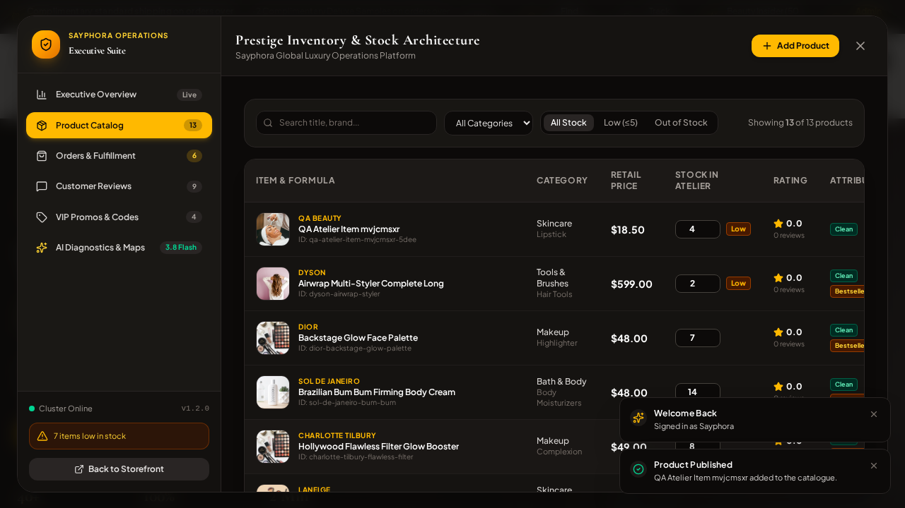</a>

<strong>Product successfully published</strong> After saving a product, staff can see the new catalogue item in inventory. Desktop view · <a href="screenshots/48-admin-product-created.png">View full-size image</a>

</td>
</tr>
</table>

### Update stock and identify low inventory

Inventory controls allow staff to update available units; the low-stock view helps bring attention to stock that needs action.

<table>
<tr>
<td width="50%" valign="top">

<strong>BEFORE · INVENTORY</strong>

<a href="screenshots/33-admin-product-catalog.png">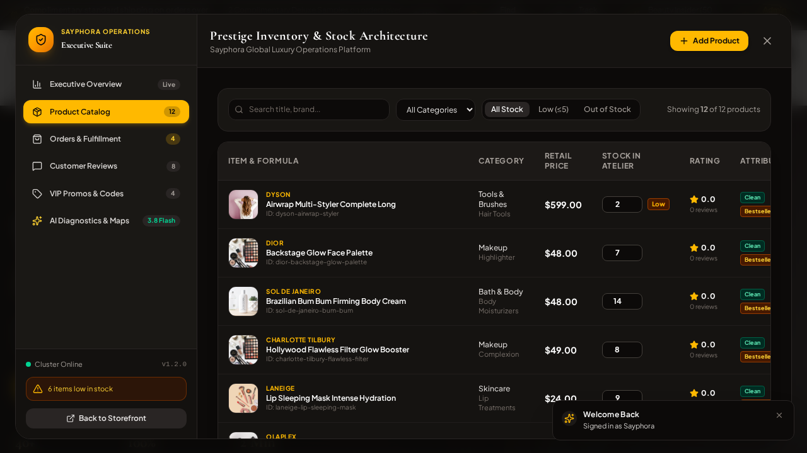</a>

<strong>Product inventory and stock controls</strong> Staff can browse the catalogue and reach inventory controls from the product table. Desktop view · <a href="screenshots/33-admin-product-catalog.png">View full-size image</a>

</td>
<td width="50%" valign="top">

<strong>AFTER · UPDATED STOCK</strong>

<a href="screenshots/49-admin-low-stock-update.png">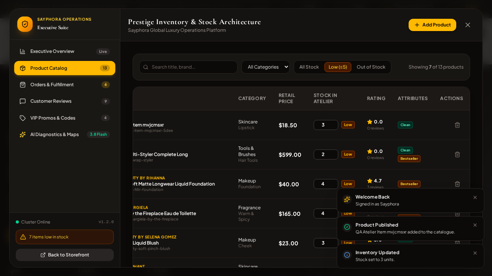</a>

<strong>Inventory updated and low-stock filtered</strong> The stock count persists and the low-stock view highlights the inventory that needs attention. Desktop view · <a href="screenshots/49-admin-low-stock-update.png">View full-size image</a>

</td>
</tr>
</table>

### Manage order fulfilment and customer reviews

Separate console areas give staff the tools to inspect the order queue and manage customer feedback.

<table>
<tr>
<td width="50%" valign="top">

<strong>ORDER MANAGEMENT</strong>

<a href="screenshots/35-admin-order-management.png">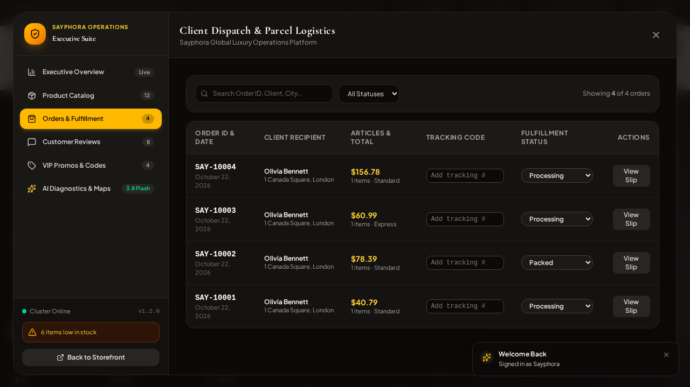</a>

<strong>Order queue and fulfilment controls</strong> Order management exposes the queue and the available fulfilment controls. Desktop view · <a href="screenshots/35-admin-order-management.png">View full-size image</a>

</td>
<td width="50%" valign="top">

<strong>REVIEW MODERATION</strong>

<a href="screenshots/36-admin-review-moderation.png">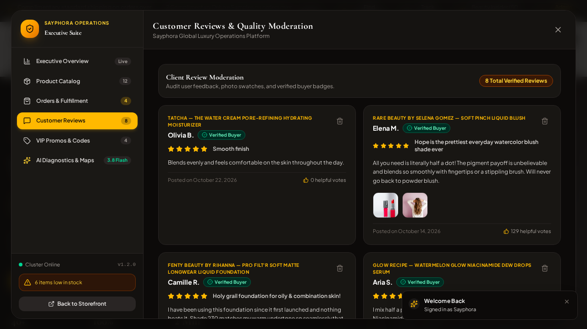</a>

<strong>Customer review moderation</strong> The review console gives staff a place to inspect customer feedback and moderation options. Desktop view · <a href="screenshots/36-admin-review-moderation.png">View full-size image</a>

</td>
</tr>
</table>

### Move an order through fulfilment

The order view reflects a fulfilment-state change so staff can see where an order is in the process.

<table>
<tr>
<td width="50%" valign="top">

<strong>BEFORE · ORDER IN QUEUE</strong>

<a href="screenshots/11-admin-order-before-update.png">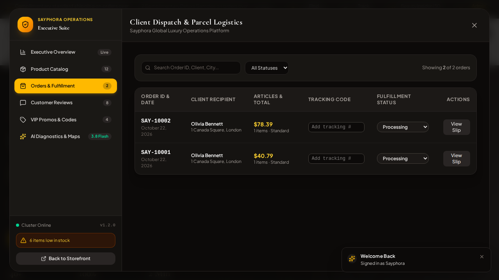</a>

<strong>Staff order queue</strong> Staff can open the order queue and inspect an order before changing its fulfilment status. Desktop view · <a href="screenshots/11-admin-order-before-update.png">View full-size image</a>

</td>
<td width="50%" valign="top">

<strong>AFTER · ORDER MARKED PACKED</strong>

<a href="screenshots/12-admin-order-updated.png">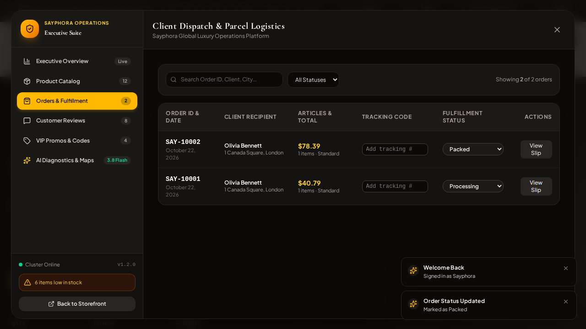</a>

<strong>Order marked Packed</strong> The order view reflects the updated fulfilment state. Desktop view · <a href="screenshots/12-admin-order-updated.png">View full-size image</a>

</td>
</tr>
</table>

### Set up a promotion

Staff can see existing campaigns and open the form to define a new code and discount.

<table>
<tr>
<td width="50%" valign="top">

<strong>PROMOTION LIST</strong>

<a href="screenshots/37-admin-promotion-management.png">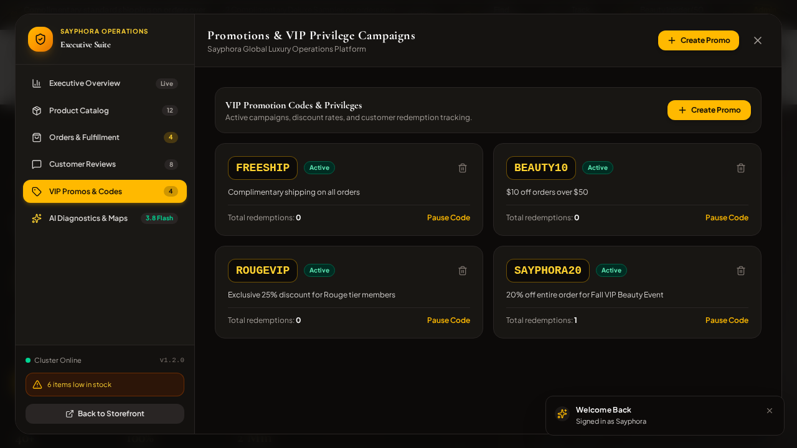</a>

<strong>Promotion code administration</strong> The promotion area lists campaigns and exposes their management actions. Desktop view · <a href="screenshots/37-admin-promotion-management.png">View full-size image</a>

</td>
<td width="50%" valign="top">

<strong>NEW PROMOTION FORM</strong>

<a href="screenshots/38-admin-promo-create-form.png">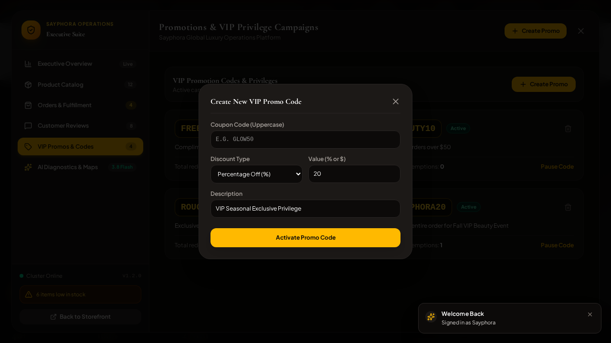</a>

<strong>New promotion form</strong> The promotion editor gathers the code, discount details and description for a new campaign. Desktop view · <a href="screenshots/38-admin-promo-create-form.png">View full-size image</a>

</td>
</tr>
</table>

### Create a campaign, then pause it

After the campaign is created, staff can pause it and see the changed campaign state.

<table>
<tr>
<td width="50%" valign="top">

<strong>BEFORE · CAMPAIGN ACTIVE</strong>

<strong>Promotion created from the staff console</strong> The newly created campaign appears in the promotion list. Desktop view · <a href="screenshots/50-admin-promo-created.png">View full-size image</a>

</td>
<td width="50%" valign="top">

<strong>AFTER · CAMPAIGN PAUSED</strong>

<a href="screenshots/51-admin-promo-paused.png">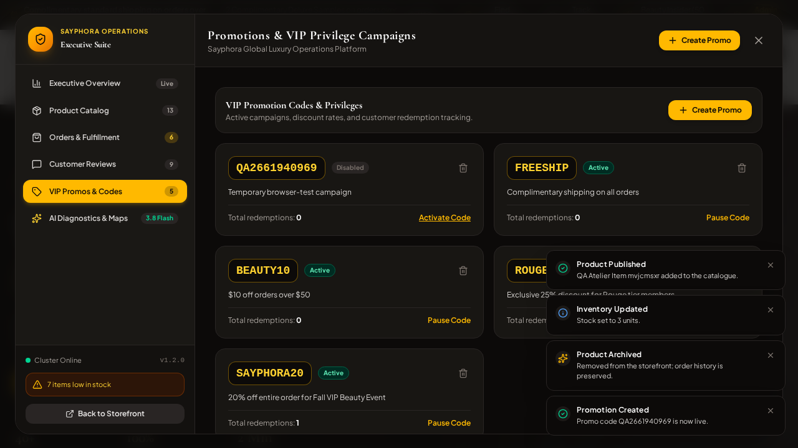</a>

<strong>Promotion pause state</strong> The campaign's paused state is reflected in the promotion controls. Desktop view · <a href="screenshots/51-admin-promo-paused.png">View full-size image</a>

</td>
</tr>
</table>

## Availability and integration notes

The core storefront, account, bag, order, catalogue, wishlist, review, loyalty and staff-console experiences are part of the application. A few capabilities depend on deployment configuration or external systems:

- **Beauty concierge:** catalogue-aware guidance is available through the configured fallback. Live Gemini responses require a provider key and working provider access.
- **Boutique locator:** the built-in directory can be displayed without live Maps data. Live place grounding and device location require the relevant Google Maps setup and browser permission.
- **Payments:** checkout currently supports **pay on delivery**; card processing and payment settlement are not implemented as a live gateway.
- **Shipping:** customers can view application-managed order progress; live carrier tracking updates require a carrier integration.
- **Email:** email delivery such as order/reset messages depends on SMTP being configured.
- **Install/offline:** the app includes a service-worker cache and install guidance. The iOS guidance is a help screen, not a native iOS app.

---

[Return to the repository README](../../README.md) · [Browse all walkthrough screenshots](screenshots/)
