# Sayphora — Visual Showcase & Before/After Journeys

> A recruiter-friendly, browser-rendered walkthrough of the Sayphora storefront and staff console. Open this Markdown file on GitHub to see the screenshots inline; click an image to inspect it at full size.

**51 verified screenshot assets** · Desktop and mobile views · Customer journeys and staff workflows  
**Tested source commit:** `7c0cc57a18213e020afa6e0ee8ae0d8a2126808c`  
**Verification run:** [GitHub Actions — typecheck, PostgreSQL tests, browser E2E and Docker build](https://github.com/faizansaiyed123/Sayphora/actions/runs/39720558160) · [Screenshot evidence artifact](https://github.com/faizansaiyed123/Sayphora/actions/runs/39720558160/artifacts/12400484469)

## Showcase contents

- [Storefront and discovery](#storefront-and-discovery)
- [Account, bag and checkout journeys](#account-bag-and-checkout-journeys)
- [Product, reviews and beauty tools](#product-reviews-and-beauty-tools)
- [Loyalty, boutique and device experience](#loyalty-boutique-and-device-experience)
- [Staff console and operations](#staff-console-and-operations)
- [Coverage and verification limits](#coverage-and-verification-limits)

**Reading the comparisons:** “Before” and “After” are reserved for screenshots that reflect a real state transition in the tested flow. Related tools are labelled “Feature view” rather than passed off as a before/after. Each image is linked to its full-size repository asset, and the captions describe the tested state.

---

## Storefront and discovery

### 01 · Browse the catalogue, then refine results

The flow starts with the API-backed catalogue and then applies search, category, price and skin-type refinements, sorting and the editorial layout.

<table>
<tr>
<td width="50%" valign="top">

<strong>BEFORE · Catalogue</strong>

<strong>Storefront catalogue</strong> The storefront displays products from the API. The browser waits for a catalog item, a healthy database and a 12-product API response before this screenshot is saved. 1280 × 720 viewport · <a href="visuals/01-storefront-catalogue.png">Open full-size image</a>

</td>
<td width="50%" valign="top">

<strong>AFTER · Refined catalogue</strong>

<a href="visuals/22-storefront-refinements.png">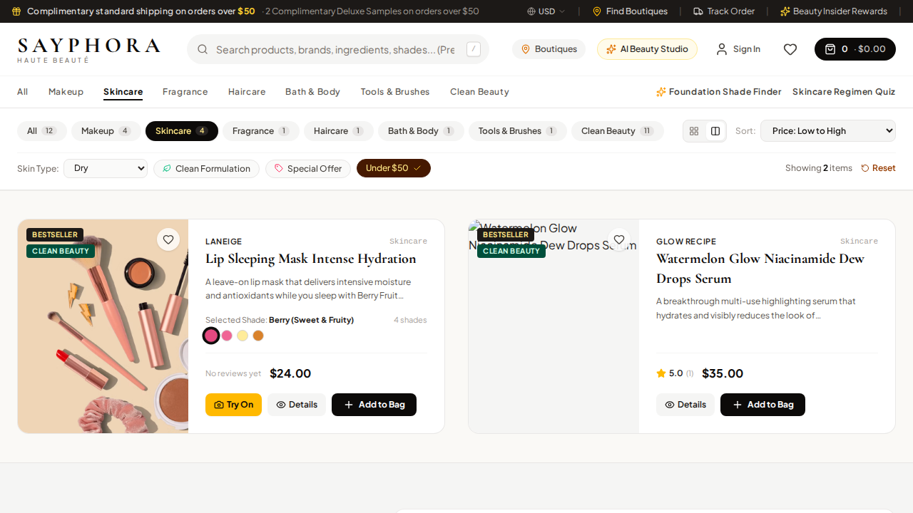</a>

<strong>Catalogue filtering, sorting and editorial view</strong> The browser search finds the catalog product, then category, price order, skin-type and under-$50 refinements plus the editorial layout are changed and checked. 1280 × 720 viewport · <a href="visuals/22-storefront-refinements.png">Open full-size image</a>

</td>
</tr>
</table>
### 02 · Newsletter and currency preference

The display currency changes to EUR and the newsletter form confirms a subscription using a synthetic example.com address.

<table>
<tr>
<td width="100%" valign="top">

<strong>FEATURE SCREEN</strong>

<a href="visuals/23-newsletter-currency.png">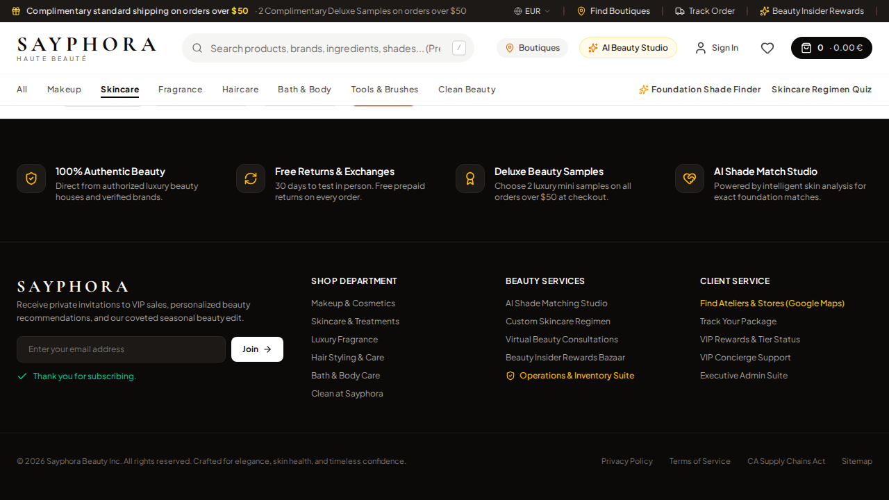</a>

<strong>Currency preference and newsletter confirmation</strong> The display currency changes to EUR and the newsletter form confirms a subscription using a synthetic example.com address. 1280 × 720 viewport · <a href="visuals/23-newsletter-currency.png">Open full-size image</a>

</td>
</tr>
</table>
## Account, bag and checkout journeys

### 03 · Registration completes

A completed synthetic registration form transitions to the authenticated shopping experience.

<table>
<tr>
<td width="50%" valign="top">

<strong>BEFORE · Registration form</strong>

<strong>Registration form</strong> A complete customer form is shown before submission. The email uses the reserved example.com domain and cannot deliver mail to a real person. 1280 × 720 viewport · <a href="visuals/02-registration-form.png">Open full-size image</a>

</td>
<td width="50%" valign="top">

<strong>AFTER · Account created</strong>

<strong>Account created</strong> The registration flow returns to the authenticated shopping experience after the UI confirms success. 1280 × 720 viewport · <a href="visuals/03-registration-success.png">Open full-size image</a>

</td>
</tr>
</table>
### 04 · Apply a promotion to the bag

The bag displays a selected catalogue item, then shows the server-accepted SAYPHORA20 promotion.

<table>
<tr>
<td width="50%" valign="top">

<strong>BEFORE · Bag</strong>

<strong>Product added to the bag</strong> The cart drawer is open and the checkout action is available after selecting a product from the seeded catalog. 1280 × 720 viewport · <a href="visuals/04-shopping-bag.png">Open full-size image</a>

</td>
<td width="50%" valign="top">

<strong>AFTER · Promotion accepted</strong>

<strong>Promotion accepted</strong> The server accepts SAYPHORA20 and the cart displays the applied promotion before checkout continues. 1280 × 720 viewport · <a href="visuals/05-promotion-applied.png">Open full-size image</a>

</td>
</tr>
</table>
### 05 · Bag controls and empty state

The bag contains two foundation units, complimentary samples and a promotion; after item removal and promotion removal, the explicit empty state is shown.

<table>
<tr>
<td width="50%" valign="top">

<strong>BEFORE · Items, samples and promo</strong>

<a href="visuals/41-cart-samples-promo.png">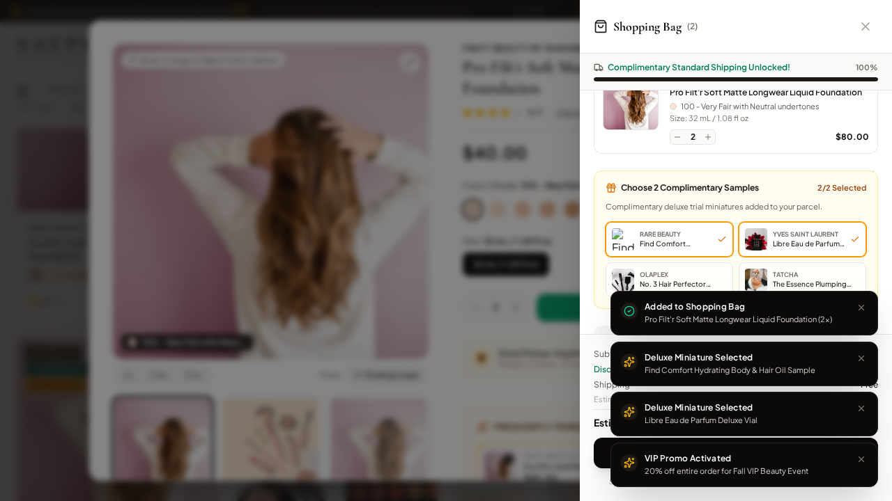</a>

<strong>Cart quantity, samples and promotion</strong> The bag contains two foundation units, two complimentary samples are selected, and the seeded SAYPHORA20 promotion is applied. 1280 × 720 viewport · <a href="visuals/41-cart-samples-promo.png">Open full-size image</a>

</td>
<td width="50%" valign="top">

<strong>AFTER · Empty bag</strong>

<a href="visuals/42-cart-empty-state.png">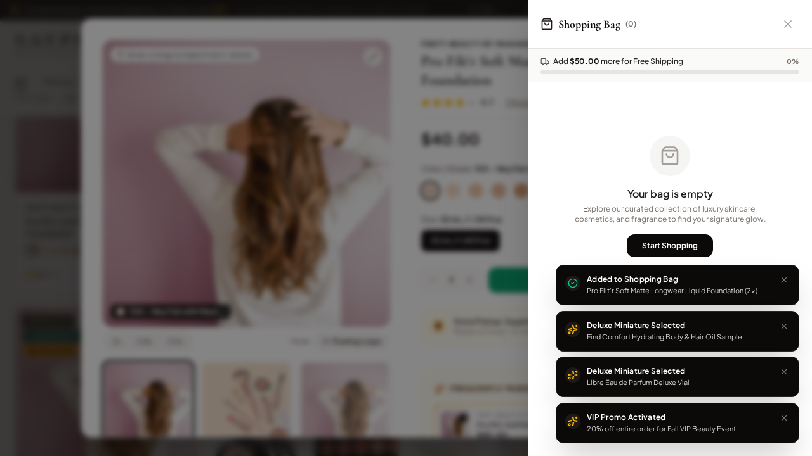</a>

<strong>Empty bag after removing the item</strong> Removing the only cart line leaves the bag in its explicit empty state after the active promotion is removed. 1280 × 720 viewport · <a href="visuals/42-cart-empty-state.png">Open full-size image</a>

</td>
</tr>
</table>
### 06 · Review the order, place it, then track it

The checkout review leads to an API-issued order number and then an order-progress timeline. Server-side order persistence and pricing are separately asserted by the test suite.

<table>
<tr>
<td width="33.333333333333336%" valign="top">

<strong>STEP 1 · CHECKOUT REVIEW</strong>

<strong>Checkout review</strong> Valid shipping details reach the review step. The supported pay-on-delivery option is present before the order is submitted. 1280 × 720 viewport · <a href="visuals/06-checkout-review.png">Open full-size image</a>

</td>
<td width="33.333333333333336%" valign="top">

<strong>STEP 2 · ORDER CREATED</strong>

<strong>Order confirmation</strong> The application displays a server-issued order number. The saved order, ownership, items, loyalty points, status and server-calculated total are verified through the API. 1280 × 720 viewport · <a href="visuals/07-order-confirmation.png">Open full-size image</a>

</td>
<td width="33.333333333333336%" valign="top">

<strong>STEP 3 · ORDER TRACKING</strong>

<strong>Order tracking</strong> The tracking dialog displays the same order number returned by the API and a visible order-progress timeline. 1280 × 720 viewport · <a href="visuals/08-order-tracking.png">Open full-size image</a>

</td>
</tr>
</table>
### 07 · Configure a gift, then review it

The shipping step configures express delivery, address saving, gift packaging and a message before showing the resulting review.

<table>
<tr>
<td width="50%" valign="top">

<strong>BEFORE · Shipping and gift choices</strong>

<a href="visuals/26-checkout-gift-options.png">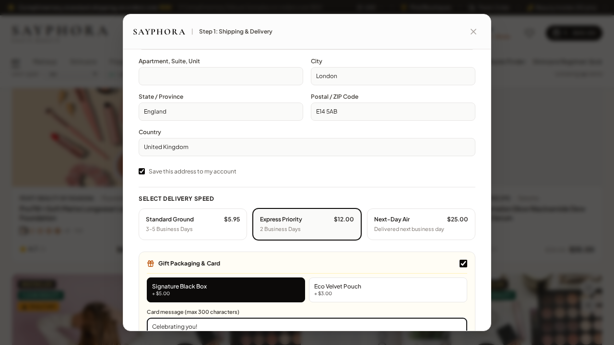</a>

<strong>Express delivery and gift options</strong> The shipping step selects express delivery, enables address saving, and configures a gift box and message before reviewing the order. 1280 × 720 viewport · <a href="visuals/26-checkout-gift-options.png">Open full-size image</a>

</td>
<td width="50%" valign="top">

<strong>AFTER · Checkout review</strong>

<a href="visuals/27-checkout-gift-review.png">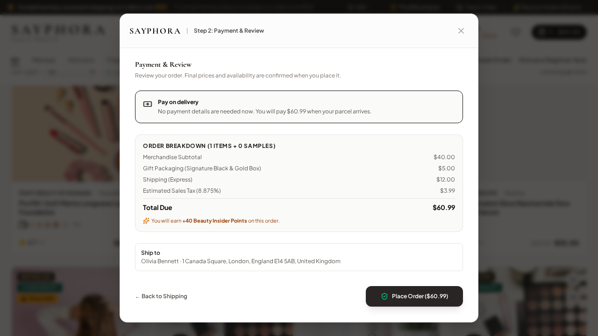</a>

<strong>Checkout review with gift packaging</strong> The review step displays pay-on-delivery, the selected gift presentation and the current server-pricing summary before order placement. 1280 × 720 viewport · <a href="visuals/27-checkout-gift-review.png">Open full-size image</a>

</td>
</tr>
</table>
## Product, reviews and beauty tools

### 08 · From product detail to verified customer feedback

The product view leads into verified-purchase feedback. A separate signed-in customer can filter to verified buyers and mark a review helpful.

<table>
<tr>
<td width="33.333333333333336%" valign="top">

<strong>STEP 1 · PRODUCT DETAILS</strong>

<strong>Product details</strong> The product detail view is opened for an item returned by the catalog API, and its review entry point is visible before continuing. 1280 × 720 viewport · <a href="visuals/09-product-detail.png">Open full-size image</a>

</td>
<td width="33.333333333333336%" valign="top">

<strong>STEP 2 · VERIFIED-PURCHASE REVIEW</strong>

<strong>Verified purchase review</strong> The review confirmation is visible. The API independently verifies the review title and verified-purchase flag for the account that placed the order. 1280 × 720 viewport · <a href="visuals/10-verified-product-review.png">Open full-size image</a>

</td>
<td width="33.333333333333336%" valign="top">

<strong>STEP 3 · REVIEW FILTER AND VOTE</strong>

<a href="visuals/44-review-vote-filter.png">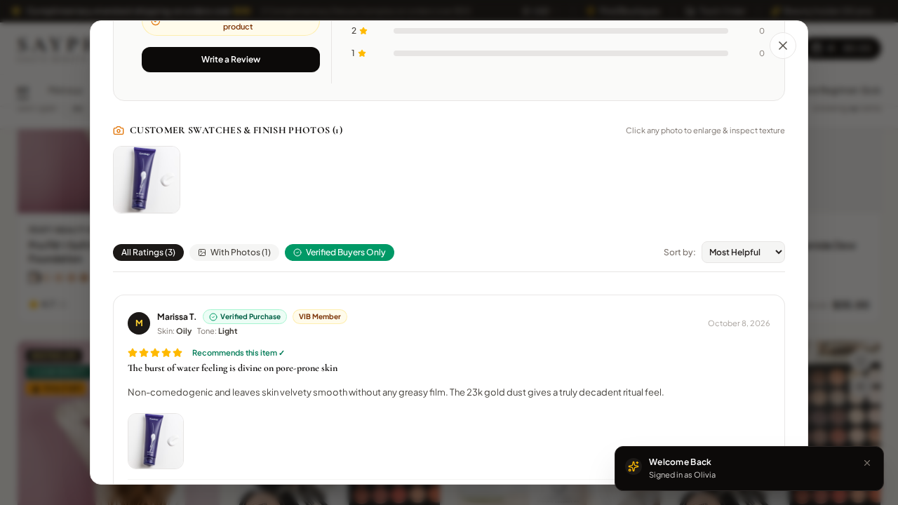</a>

<strong>Verified review filter and helpful voting</strong> A second signed-in customer marks another customer’s verified-purchase review helpful and filters the list to verified buyers. 1280 × 720 viewport · <a href="visuals/44-review-vote-filter.png">Open full-size image</a>

</td>
</tr>
</table>
### 09 · Virtual try-on connects to the bag

The selected foundation finish is changed in the mirror, then the same seeded product is added to the shopping bag.

<table>
<tr>
<td width="50%" valign="top">

<strong>BEFORE · Try-on studio</strong>

<strong>Virtual try-on studio</strong> The virtual mirror opens for a real foundation from the seeded catalog. The finish control is changed before the screenshot is captured. 1280 × 720 viewport · <a href="visuals/15-virtual-try-on.png">Open full-size image</a>

</td>
<td width="50%" valign="top">

<strong>AFTER · Shade in bag</strong>

<strong>Try-on shade added to the bag</strong> After adding the selected finish, the shopping bag opens with the same seeded foundation. This confirms the mirror action reaches the cart drawer. 1280 × 720 viewport · <a href="visuals/16-vto-shade-added-to-bag.png">Open full-size image</a>

</td>
</tr>
</table>
### 10 · Product decision tools

Two product-detail tools are shown side by side: attribute comparison and full-screen image inspection. These are companion features, not a before/after transition.

<table>
<tr>
<td width="50%" valign="top">

<strong>FEATURE VIEW · Comparison</strong>

<strong>Side-by-side product comparison</strong> Two seeded catalog products appear together in the comparison matrix, with customer rating, finish, coverage and skin-type attributes. 1280 × 720 viewport · <a href="visuals/14-product-comparison.png">Open full-size image</a>

</td>
<td width="50%" valign="top">

<strong>FEATURE VIEW · Image inspection</strong>

<a href="visuals/24-product-gallery-lightbox.png">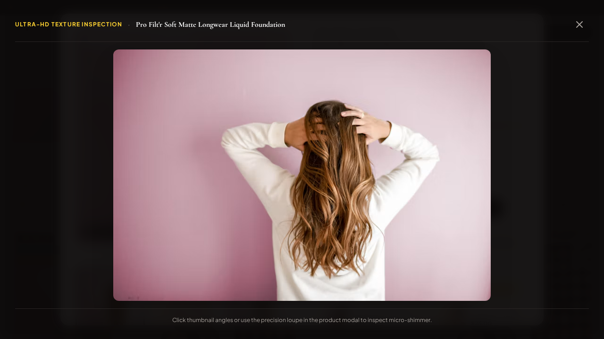</a>

<strong>Product image lightbox</strong> The product image opens in the full-screen inspection lightbox and exposes its dedicated close control. 1280 × 720 viewport · <a href="visuals/24-product-gallery-lightbox.png">Open full-size image</a>

</td>
</tr>
</table>
### 11 · Ingredient diagnostics and shade matching

Ingredient information sits alongside a deterministic catalogue-backed shade match. The shade matcher screenshot is not evidence of live external AI generation.

<table>
<tr>
<td width="50%" valign="top">

<strong>FEATURE VIEW · Ingredients</strong>

<strong>Ingredient safety diagnostic</strong> The product diagnostic displays its standard, pore-clog index, formula pH and ingredient safety information for the selected catalog product. 1280 × 720 viewport · <a href="visuals/17-ingredient-diagnostics.png">Open full-size image</a>

</td>
<td width="50%" valign="top">

<strong>FEATURE VIEW · Shade match</strong>

<strong>Personalised shade match</strong> The deterministic catalog-backed matcher returns an in-stock shade for the selected medium depth and warm undertone; this is not a live Gemini-provider test. 1280 × 720 viewport · <a href="visuals/18-shade-match.png">Open full-size image</a>

</td>
</tr>
</table>
### 12 · Routine builder and beauty concierge

The routine builder separates AM and PM steps; the concierge response uses the configured catalogue-backed response/fallback path.

<table>
<tr>
<td width="50%" valign="top">

<strong>FEATURE VIEW · AM/PM routine</strong>

<strong>Morning and evening routine</strong> The deterministic routine builder recommends real catalog products in separate AM and PM steps. Live external AI generation remains a separate integration check. 1280 × 720 viewport · <a href="visuals/19-skincare-routine.png">Open full-size image</a>

</td>
<td width="50%" valign="top">

<strong>FEATURE VIEW · Concierge</strong>

<a href="visuals/30-ai-concierge.png">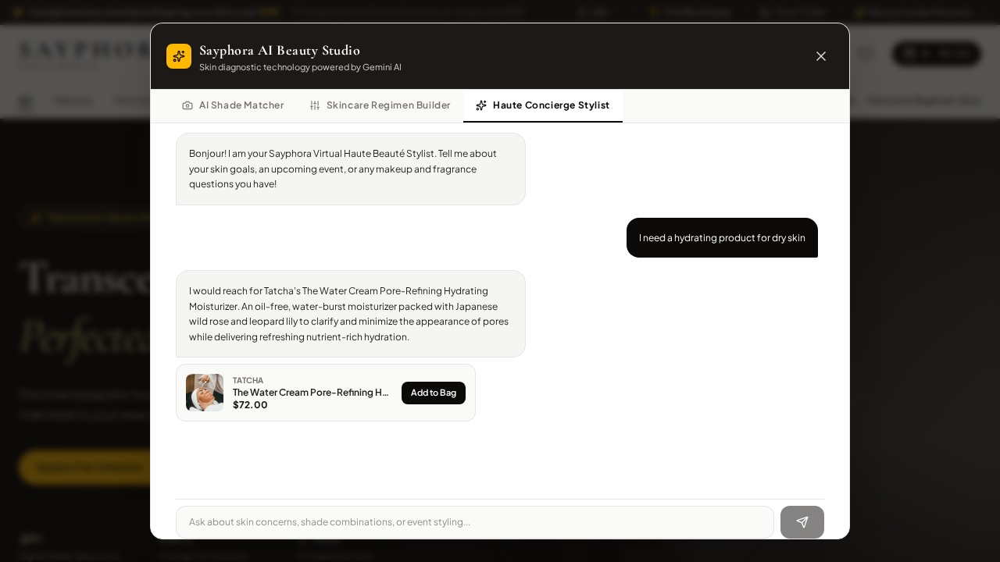</a>

<strong>Concierge product recommendation</strong> A visitor asks the concierge for hydration help and receives a recommendation tied to a product in the seeded catalogue. CI uses the configured fallback when no live Gemini credential is supplied. 1280 × 720 viewport · <a href="visuals/30-ai-concierge.png">Open full-size image</a>

</td>
</tr>
</table>
### 13 · Product bundle and sizing/application routine

The bundle builder displays selected companion products and a saving. The product-detail state shows the 75 mL option, quantity two, calculated total and product-specific application-routine tab.

<table>
<tr>
<td width="50%" valign="top">

<strong>FEATURE VIEW · Bundle builder</strong>

<a href="visuals/25-product-bundle-builder.png">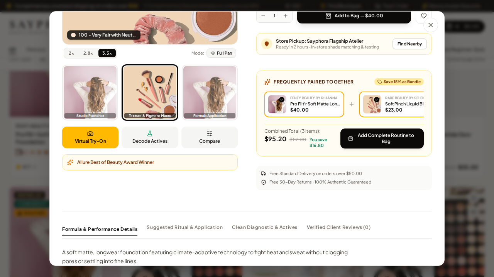</a>

<strong>Curated product bundle</strong> The frequently-paired product builder shows the selected companions and its 15% bundle saving before the bundle is added. 1280 × 720 viewport · <a href="visuals/25-product-bundle-builder.png">Open full-size image</a>

</td>
<td width="50%" valign="top">

<strong>FEATURE VIEW · Size and routine</strong>

<a href="visuals/43-product-size-and-ritual.png">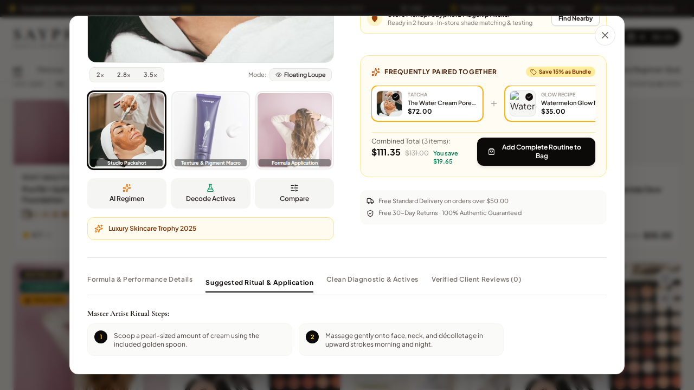</a>

<strong>Product size, quantity and application routine</strong> The 75 mL option and quantity two are selected, the add-to-bag total reflects $144, and the product-specific application-routine tab is opened. 1280 × 720 viewport · <a href="visuals/43-product-size-and-ritual.png">Open full-size image</a>

</td>
</tr>
</table>
## Loyalty, boutique and device experience

### 14 · Redeem a loyalty reward

The member sees their balance and an eligible reward, then receives a single-use redemption code with a verified point-balance update.

<table>
<tr>
<td width="50%" valign="top">

<strong>BEFORE · Rewards available</strong>

<a href="visuals/28-loyalty-bazaar.png">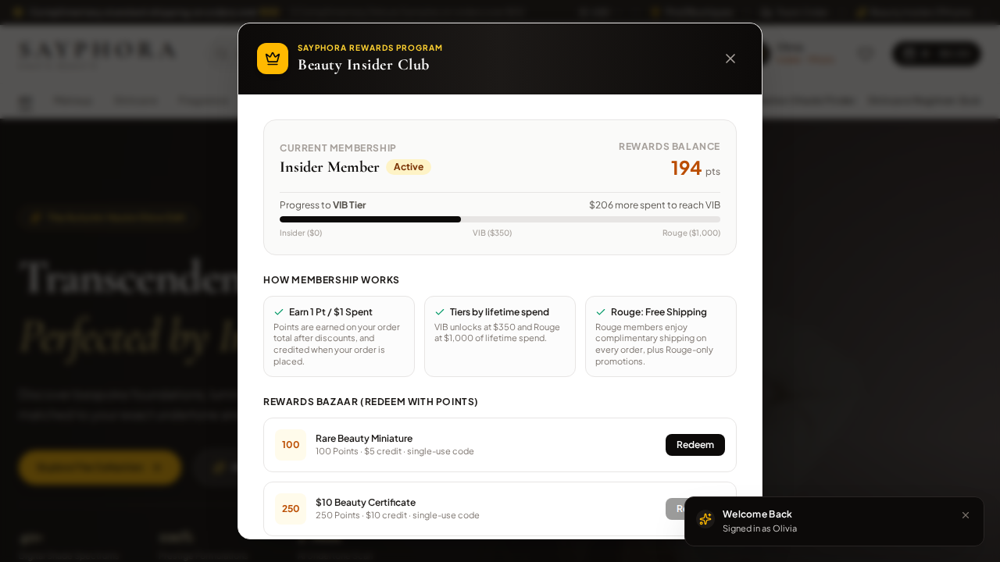</a>

<strong>Member rewards bazaar</strong> An authenticated member sees the balance and a redeemable reward after an order has earned enough points. 1280 × 720 viewport · <a href="visuals/28-loyalty-bazaar.png">Open full-size image</a>

</td>
<td width="50%" valign="top">

<strong>AFTER · Reward code issued</strong>

<a href="visuals/29-loyalty-redemption.png">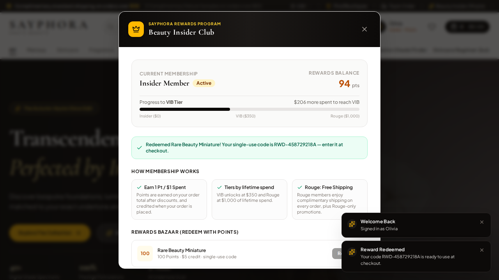</a>

<strong>Reward code issued</strong> Redeeming the reward produces a customer-visible single-use code and updates the member’s available points. 1280 × 720 viewport · <a href="visuals/29-loyalty-redemption.png">Open full-size image</a>

</td>
</tr>
</table>
### 15 · Select a preferred boutique

The selected location is visibly marked in the locator. This test uses the seeded directory/fallback rather than live Maps grounding.

<table>
<tr>
<td width="50%" valign="top">

<strong>BEFORE · Boutique directory</strong>

<strong>Boutique directory</strong> The locator displays the seeded boutique directory using the built-in fallback path; no GPS permission is requested. 1280 × 720 viewport · <a href="visuals/20-boutique-directory.png">Open full-size image</a>

</td>
<td width="50%" valign="top">

<strong>AFTER · Pickup location selected</strong>

<strong>Pickup location selected</strong> The selected boutique is visibly marked in the locator after the user chooses it as the preferred pickup location. 1280 × 720 viewport · <a href="visuals/21-pickup-store-selected.png">Open full-size image</a>

</td>
</tr>
</table>
### 16 · Offline catalogue and install guidance

The service worker serves cached catalogue content while offline; the iOS capture demonstrates install-help UI, not a physical-device installation.

<table>
<tr>
<td width="50%" valign="top">

<strong>FEATURE VIEW · Offline catalogue</strong>

<strong>Cached product catalogue while offline</strong> The production web app exposes a standalone manifest and registered service worker; after the public catalogue is cached, the browser retrieves its twelve products while network access is disabled. 1280 × 720 viewport · <a href="visuals/31-pwa-offline-catalog.png">Open full-size image</a>

</td>
<td width="50%" valign="top">

<strong>FEATURE VIEW · iOS install help</strong>

<a href="visuals/47-ios-install-guide.png">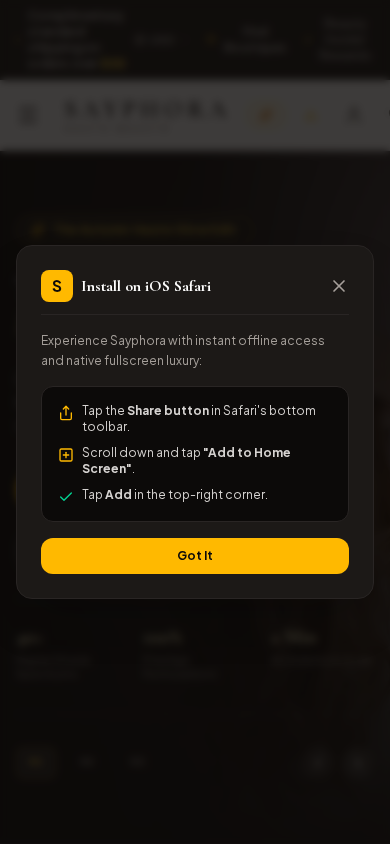</a>

<strong>iOS add-to-home-screen instructions</strong> An iPhone Safari-like user-agent triggers the iOS install guidance modal. This validates the guidance UI, not a physical-device installation. 390 × 844 viewport · <a href="visuals/47-ios-install-guide.png">Open full-size image</a>

</td>
</tr>
</table>
### 17 · Responsive mobile navigation and order action

Both screenshots use the 390 × 844 mobile viewport. The customer flow rejects an invalid order lookup, finds the signed-in customer’s own order and confirms its persisted cancellation.

<table>
<tr>
<td width="50%" valign="top">

<strong>FEATURE VIEW · Mobile navigation</strong>

<strong>Mobile navigation drawer</strong> At 390 × 844, the compact navigation exposes category selection plus the loyalty, boutique and order-tracking entry points. 390 × 844 viewport · <a href="visuals/46-mobile-navigation.png">Open full-size image</a>

</td>
<td width="50%" valign="top">

<strong>FEATURE VIEW · Order cancellation</strong>

<a href="visuals/45-customer-order-cancelled.png">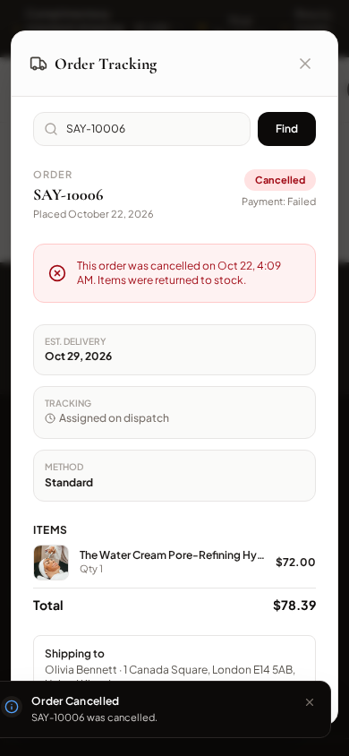</a>

<strong>Order lookup and eligible cancellation</strong> An invalid order number is rejected, the customer’s own order is found, its progress is shown, and cancellation is confirmed by the persisted Cancelled status. 390 × 844 viewport · <a href="visuals/45-customer-order-cancelled.png">Open full-size image</a>

</td>
</tr>
</table>
## Staff console and operations

### 18 · Staff overview and service diagnostics

The protected staff console provides an operations overview and a separate diagnostics view for AI, Maps and PWA controls.

<table>
<tr>
<td width="50%" valign="top">

<strong>FEATURE VIEW · Staff overview</strong>

<a href="visuals/32-admin-overview.png">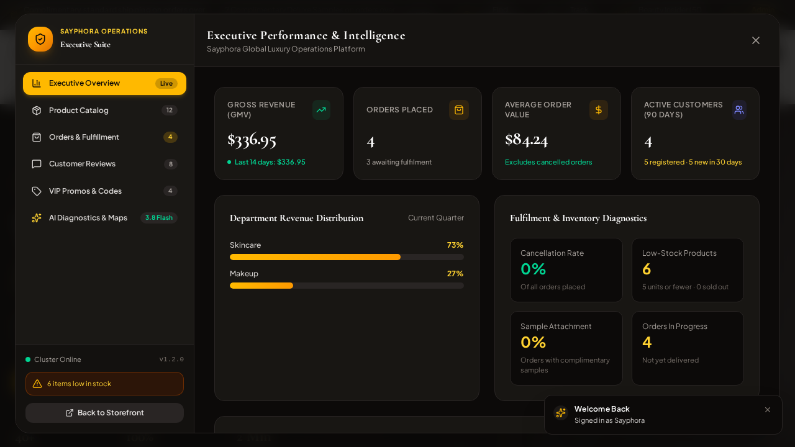</a>

<strong>Staff executive overview</strong> The seeded administrator enters the protected operations console and sees its analytics overview. 1280 × 720 viewport · <a href="visuals/32-admin-overview.png">Open full-size image</a>

</td>
<td width="50%" valign="top">

<strong>FEATURE VIEW · AI/Maps/PWA diagnostics</strong>

<a href="visuals/39-admin-ai-maps-pwa.png">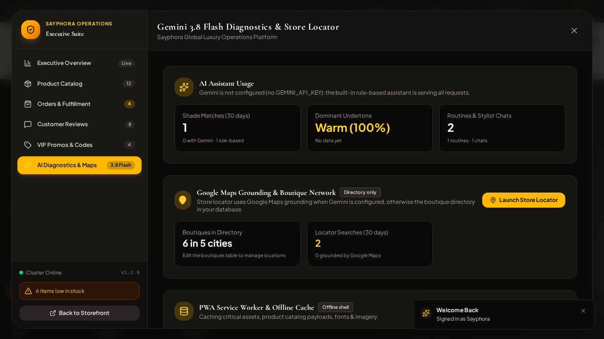</a>

<strong>AI, Maps and PWA diagnostics</strong> The admin diagnostics page shows AI usage counters, the boutique directory, Google Maps grounding area and the service-worker cache controls. 1280 × 720 viewport · <a href="visuals/39-admin-ai-maps-pwa.png">Open full-size image</a>

</td>
</tr>
</table>
### 19 · Create and publish a product

The staff user submits a temporary test product; it appears in inventory after the server accepts it.

<table>
<tr>
<td width="50%" valign="top">

<strong>BEFORE · Product form</strong>

<a href="visuals/34-admin-product-create-form.png">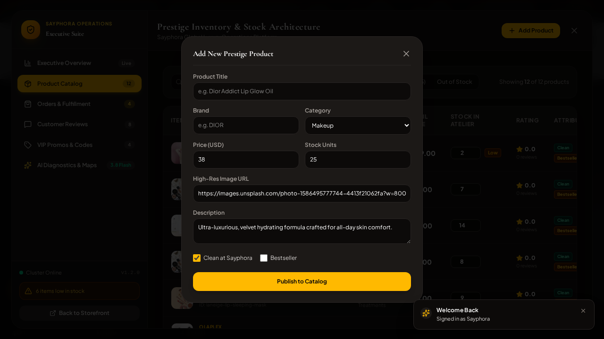</a>

<strong>New product form</strong> The product-creation form exposes the fields used to publish a catalog item; this visual check does not submit test merchandise. 1280 × 720 viewport · <a href="visuals/34-admin-product-create-form.png">Open full-size image</a>

</td>
<td width="50%" valign="top">

<strong>AFTER · Product created</strong>

<a href="visuals/48-admin-product-created.png">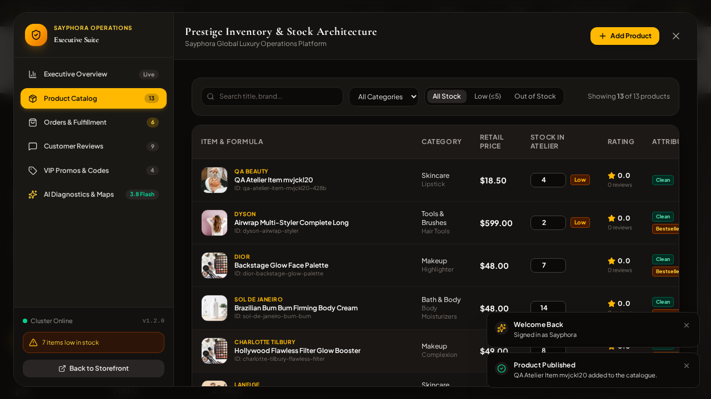</a>

<strong>Product successfully published</strong> The staff user submits the product form and the new test product appears in the inventory table after the server accepts it. 1280 × 720 viewport · <a href="visuals/48-admin-product-created.png">Open full-size image</a>

</td>
</tr>
</table>
### 20 · Update stock and apply the low-stock filter

The stock editor persists three units, and the low-stock filter still finds the item after the table reloads.

<table>
<tr>
<td width="50%" valign="top">

<strong>BEFORE · Inventory table</strong>

<a href="visuals/33-admin-product-catalog.png">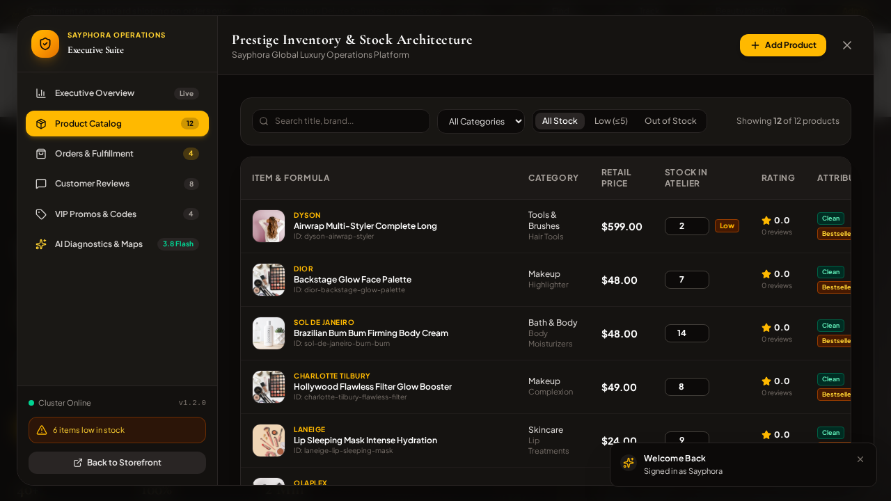</a>

<strong>Product inventory and stock controls</strong> The product tab exposes catalog search, category and stock filters, inventory editing, ratings and archive actions. 1280 × 720 viewport · <a href="visuals/33-admin-product-catalog.png">Open full-size image</a>

</td>
<td width="50%" valign="top">

<strong>AFTER · Stock persisted and filtered</strong>

<a href="visuals/49-admin-low-stock-update.png">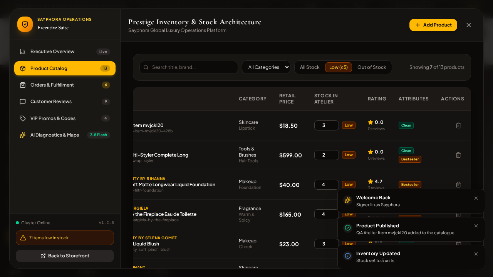</a>

<strong>Inventory updated and low-stock filtered</strong> The stock editor persists three units; the low-stock filter still finds the item after the table reloads from server data. 1280 × 720 viewport · <a href="visuals/49-admin-low-stock-update.png">Open full-size image</a>

</td>
</tr>
</table>
### 21 · Staff order management and review moderation

Related areas of the staff console: the order queue, status and tracking controls, plus review verification and moderation actions.

<table>
<tr>
<td width="50%" valign="top">

<strong>FEATURE VIEW · Order management</strong>

<a href="visuals/35-admin-order-management.png">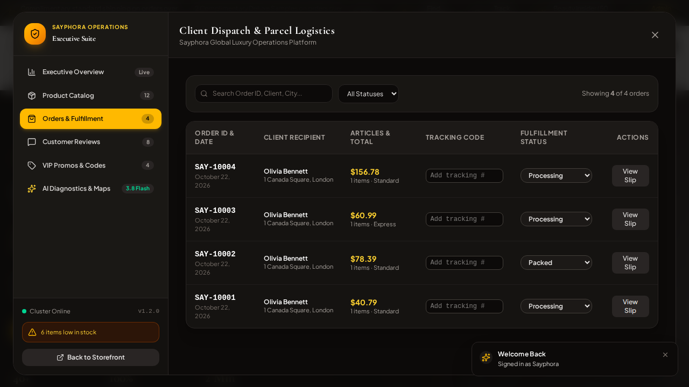</a>

<strong>Order queue and fulfilment controls</strong> The staff orders tab exposes order search, status filtering, tracking-code entry and guarded fulfillment transitions. 1280 × 720 viewport · <a href="visuals/35-admin-order-management.png">Open full-size image</a>

</td>
<td width="50%" valign="top">

<strong>FEATURE VIEW · Review moderation</strong>

<a href="visuals/36-admin-review-moderation.png">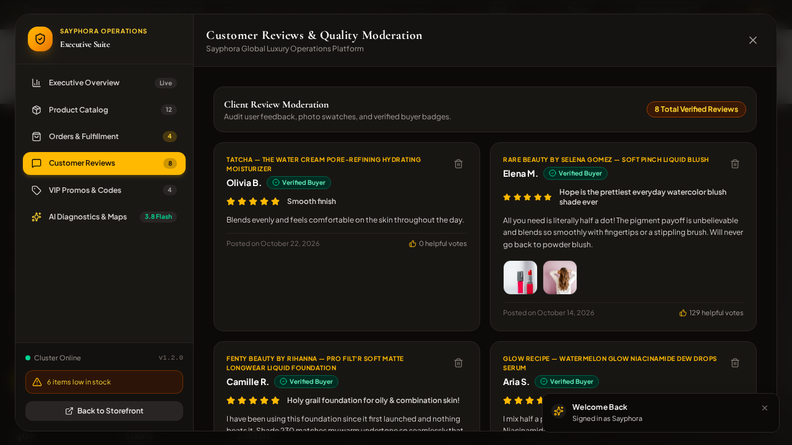</a>

<strong>Customer review moderation</strong> The protected review console lists customer feedback, verified-buyer markers and moderation actions. 1280 × 720 viewport · <a href="visuals/36-admin-review-moderation.png">Open full-size image</a>

</td>
</tr>
</table>
### 22 · Fulfil an order

The UI and API confirm the persisted Processing → Packed status transition and event history.

<table>
<tr>
<td width="50%" valign="top">

<strong>BEFORE · Order in queue</strong>

<strong>Staff order queue</strong> After staff authentication, the fulfillment queue displays the order before a status transition is requested. 1280 × 720 viewport · <a href="visuals/11-admin-order-before-update.png">Open full-size image</a>

</td>
<td width="50%" valign="top">

<strong>AFTER · Order marked Packed</strong>

<strong>Order marked Packed</strong> The UI confirms the change, and the API confirms the persisted Packed status and the Processing → Packed event history. 1280 × 720 viewport · <a href="visuals/12-admin-order-updated.png">Open full-size image</a>

</td>
</tr>
</table>
### 23 · Manage a promotion from list to paused campaign

The administrator moves from the campaign list to the creation form, creates a temporary promotion, and pauses it. The last two captures show the active campaign and its disabled state.

<table>
<tr>
<td width="25%" valign="top">

<strong>STEP 1 · PROMOTION LIST</strong>

<strong>Promotion code administration</strong> The promotion tab displays active campaigns and redemption counts with controls to create, activate, deactivate and remove codes. 1280 × 720 viewport · <a href="visuals/37-admin-promotion-management.png">Open full-size image</a>

</td>
<td width="25%" valign="top">

<strong>STEP 2 · CREATE FORM</strong>

<a href="visuals/38-admin-promo-create-form.png">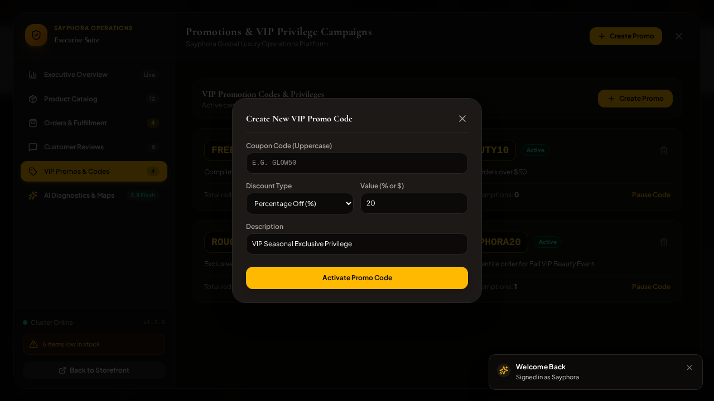</a>

<strong>New promotion form</strong> The promotion form exposes code, discount type, value and description fields. No promotion is created in this visual-only check. 1280 × 720 viewport · <a href="visuals/38-admin-promo-create-form.png">Open full-size image</a>

</td>
<td width="25%" valign="top">

<strong>STEP 3 · CAMPAIGN CREATED</strong>

<strong>Promotion created from the staff console</strong> The administrator creates a temporary campaign in the browser and the new active promotion is shown in the persisted promo list. 1280 × 720 viewport · <a href="visuals/50-admin-promo-created.png">Open full-size image</a>

</td>
<td width="25%" valign="top">

<strong>STEP 4 · CAMPAIGN PAUSED</strong>

<a href="visuals/51-admin-promo-paused.png">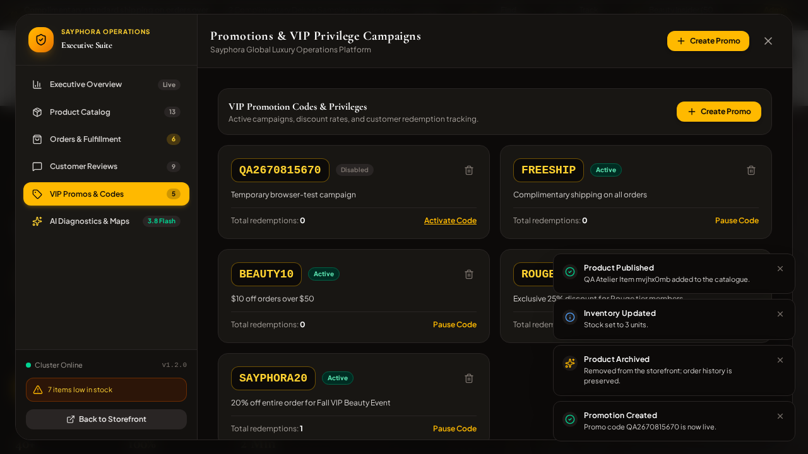</a>

<strong>Promotion pause state</strong> The administrator pauses the newly created code and the UI reflects its disabled state after the server update. 1280 × 720 viewport · <a href="visuals/51-admin-promo-paused.png">Open full-size image</a>

</td>
</tr>
</table>
### 24 · Save a wishlist, then share it

The saved item is visible in the wishlist and the share action confirms the storefront link.

<table>
<tr>
<td width="50%" valign="top">

<strong>BEFORE · Saved wishlist</strong>

<strong>Saved wishlist</strong> A real seeded catalog product has been saved, and the wishlist drawer displays the selected item before any bag action. 1280 × 720 viewport · <a href="visuals/13-saved-wishlist.png">Open full-size image</a>

</td>
<td width="50%" valign="top">

<strong>AFTER · Share action confirmed</strong>

<a href="visuals/40-wishlist-share-link.png">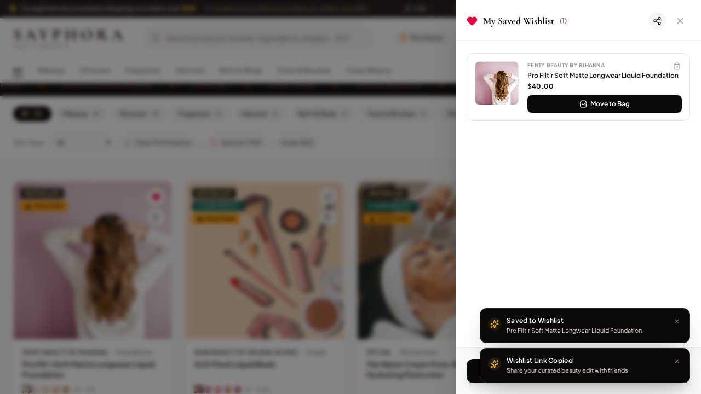</a>

<strong>Shareable wishlist link</strong> The share action copies the storefront link when clipboard access is available and confirms the action in the wishlist UI. 1280 × 720 viewport · <a href="visuals/40-wishlist-share-link.png">Open full-size image</a>

</td>
</tr>
</table>
## Coverage and verification limits

### Feature coverage represented in the visual evidence

- **Storefront and discovery:** API-backed catalogue, search/refinements, sorting, newsletter confirmation and currency display preference.
- **Product experiences:** details, image inspection, comparison, size/quantity, bundle builder, virtual try-on, ingredient diagnostics, shade matching and AM/PM routines.
- **Bag and ordering:** promotion/sample controls, empty bag, checkout gift options, order creation/tracking and eligible cancellation.
- **Accounts and community:** registration, verified-purchase reviews, review filtering/helpful voting, wishlist and sharing.
- **Retention and personalisation:** loyalty redemption, concierge fallback, boutique selection.
- **Staff operations:** product creation, inventory/low-stock, order fulfilment, review moderation and promotion creation/pausing.
- **PWA/mobile:** offline catalogue, mobile navigation and iOS install-help UI.

### Boundaries — not represented as live-production proof

- Browser tests run the production build locally against disposable PostgreSQL and synthetic test accounts/addresses. This is not a deployed-domain acceptance test.
- Gemini checks exercise the deterministic fallback without a live credential. Real provider requests, quotas, failures and response quality with a live key remain unverified.
- Boutique tests use the seeded directory/fallback. Live Google Maps grounding, external place/review data and real GPS permission behavior remain unverified.
- Newsletter and password-reset contracts are exercised, but actual SMTP delivery/inbox receipt is not verified.
- Checkout supports **pay on delivery**; no live card gateway or settlement flow is available to test.
- Tracking screens and staff-assigned tracking details are checked; carrier APIs, shipment webhooks and carrier-confirmed delivery events are not verified.
- Service-worker/offline behavior and simulated iOS install guidance are tested. Actual iOS/Android installation on physical devices and push notifications are not verified.
- CI builds the Docker image but does not validate the deployed Docker Compose environment, production TLS/cookie configuration, production-domain sessions or backup/recovery procedures.

---

**Evidence standard:** Screenshots are added only after the corresponding browser assertions succeed. API tests separately cover persistence, ownership, validation, pricing and state transitions where exercised. External-service, device and production-deployment behavior is called out above rather than marked as passed.

**Complete screenshot inventory:** [Visual assets folder](https://github.com/faizansaiyed123/Sayphora/tree/main/docs/testing/visuals) · [Machine-readable manifest](https://github.com/faizansaiyed123/Sayphora/blob/main/docs/testing/visuals/manifest.json).
