# Sayphora — End-to-End Visual Walkthrough

> Curated evidence from verified browser states. A screenshot is added only after its UI assertion succeeds; failure screenshots and traces are not embedded in this walkthrough.

**Source commit:** 61d0e2076717f558f85000ba1b20183f734f58c4  
**Browser:** Chromium controlled by Playwright  
**Viewport:** Desktop Chrome configuration  
**Data:** Real catalog, stock, price and promotion records from the application seed. The checkout flow uses a generated example.com account and a local, non-shipping order; no real customer account, live email delivery or payment is used.

## How to read this walkthrough

The images follow the user journey from product discovery to order tracking, then show verified reviews and staff fulfilment. The caption under each image explains the action and the check completed before capture. Open an image to view its original resolution.

## Journey coverage

- **Storefront:** 1 screenshot(s)
- **Account creation:** 2 screenshot(s)
- **Shopping bag and promotion:** 2 screenshot(s)
- **Checkout and order tracking:** 3 screenshot(s)
- **Product reviews:** 2 screenshot(s)
- **Order fulfilment:** 2 screenshot(s)
- **Wishlist:** 1 screenshot(s)
- **Product comparison:** 1 screenshot(s)
- **Virtual try-on:** 2 screenshot(s)
- **Ingredient diagnostics:** 1 screenshot(s)
- **Beauty personalisation:** 2 screenshot(s)
- **Boutique locator:** 2 screenshot(s)

## Storefront

<table>
<tbody>
<tr>
<td width="50%" valign="top">
<h3>01. Storefront catalogue</h3>

The storefront displays products from the API. The browser waits for a catalog item, a healthy database and a 12-product API response before this screenshot is saved.

<em>Viewport: 1280 × 720</em>

</td>
<td width="50%" valign="top"></td>
</tr>
</tbody>
</table>

## Account creation

<table>
<tbody>
<tr>
<td width="50%" valign="top">
<h3>01. Registration form</h3>
<a href="visuals/02-registration-form.png">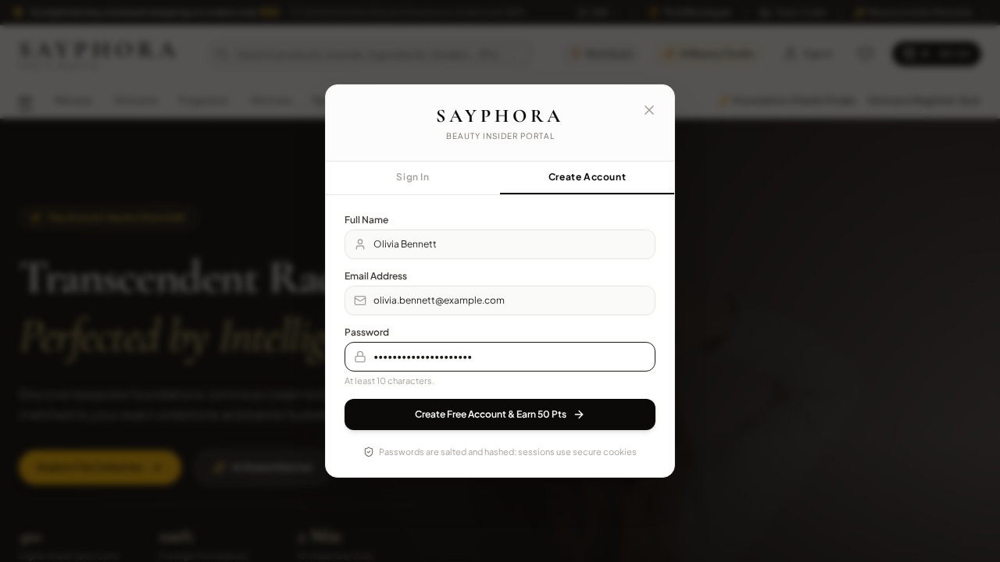</a>

A complete customer form is shown before submission. The email uses the reserved example.com domain and cannot deliver mail to a real person.

<em>Viewport: 1280 × 720</em>

</td>
<td width="50%" valign="top">
<h3>02. Account created</h3>

The registration flow returns to the authenticated shopping experience after the UI confirms success.

<em>Viewport: 1280 × 720</em>

</td>
</tr>
</tbody>
</table>

## Shopping bag and promotion

<table>
<tbody>
<tr>
<td width="50%" valign="top">
<h3>01. Product added to the bag</h3>
<a href="visuals/04-shopping-bag.png">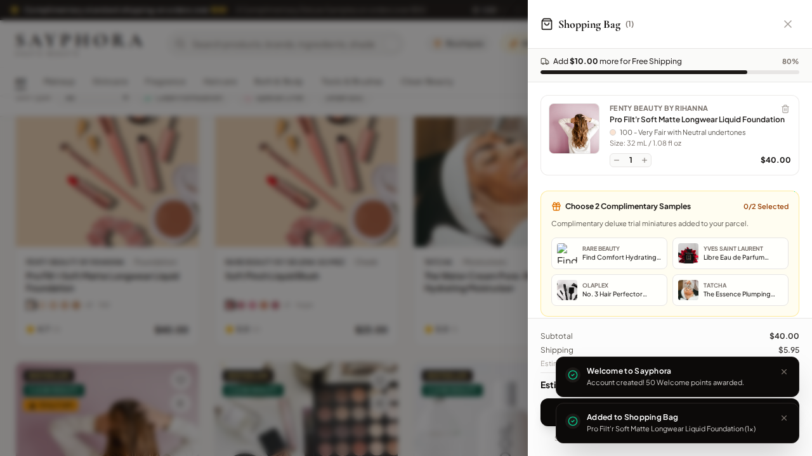</a>

The cart drawer is open and the checkout action is available after selecting a product from the seeded catalog.

<em>Viewport: 1280 × 720</em>

</td>
<td width="50%" valign="top">
<h3>02. Promotion accepted</h3>
<a href="visuals/05-promotion-applied.png">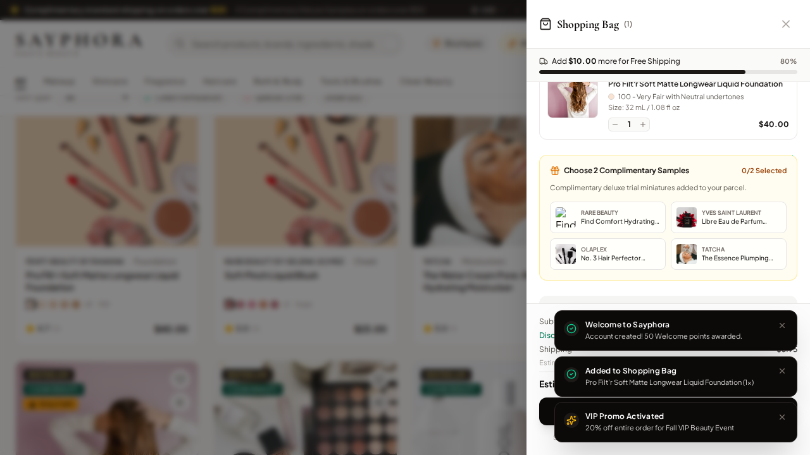</a>

The server accepts SAYPHORA20 and the cart displays the applied promotion before checkout continues.

<em>Viewport: 1280 × 720</em>

</td>
</tr>
</tbody>
</table>

## Checkout and order tracking

<table>
<tbody>
<tr>
<td width="50%" valign="top">
<h3>01. Checkout review</h3>
<a href="visuals/06-checkout-review.png">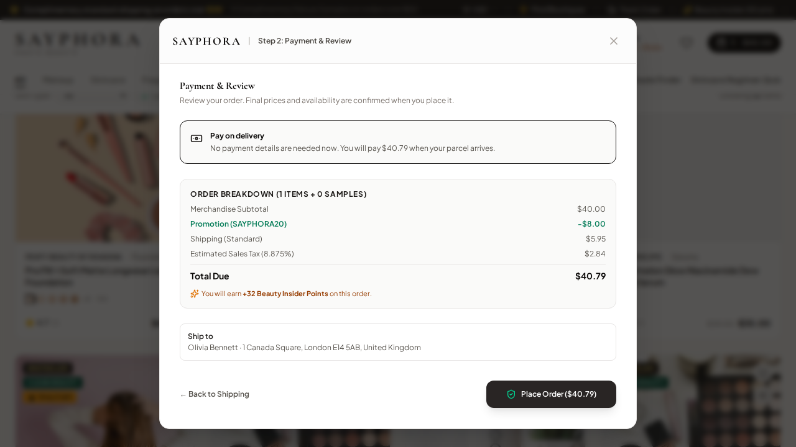</a>

Valid shipping details reach the review step. The supported pay-on-delivery option is present before the order is submitted.

<em>Viewport: 1280 × 720</em>

</td>
<td width="50%" valign="top">
<h3>02. Order confirmation</h3>
<a href="visuals/07-order-confirmation.png">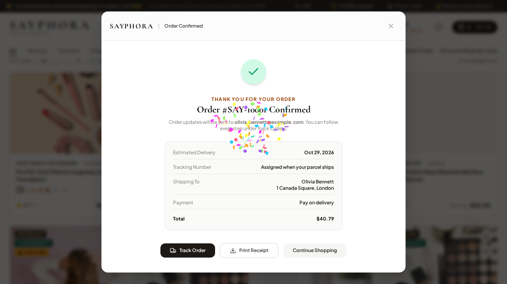</a>

The application displays a server-issued order number. The saved order, ownership, items, loyalty points, status and server-calculated total are verified through the API.

<em>Viewport: 1280 × 720</em>

</td>
</tr>
<tr>
<td width="50%" valign="top">
<h3>03. Order tracking</h3>
<a href="visuals/08-order-tracking.png">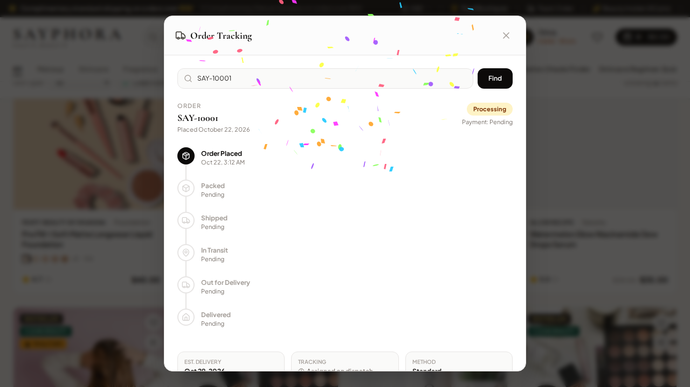</a>

The tracking dialog displays the same order number returned by the API and a visible order-progress timeline.

<em>Viewport: 1280 × 720</em>

</td>
<td width="50%" valign="top"></td>
</tr>
</tbody>
</table>

## Product reviews

<table>
<tbody>
<tr>
<td width="50%" valign="top">
<h3>01. Product details</h3>
<a href="visuals/09-product-detail.png">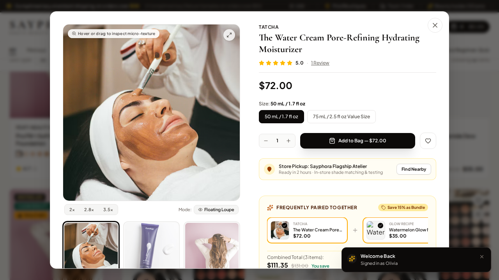</a>

The product detail view is opened for an item returned by the catalog API, and its review entry point is visible before continuing.

<em>Viewport: 1280 × 720</em>

</td>
<td width="50%" valign="top">
<h3>02. Verified purchase review</h3>
<a href="visuals/10-verified-product-review.png">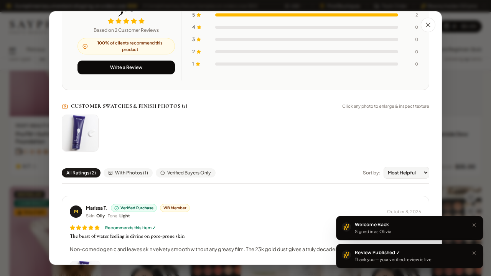</a>

The review confirmation is visible. The API independently verifies the review title and verified-purchase flag for the account that placed the order.

<em>Viewport: 1280 × 720</em>

</td>
</tr>
</tbody>
</table>

## Order fulfilment

<table>
<tbody>
<tr>
<td width="50%" valign="top">
<h3>01. Staff order queue</h3>
<a href="visuals/11-admin-order-before-update.png">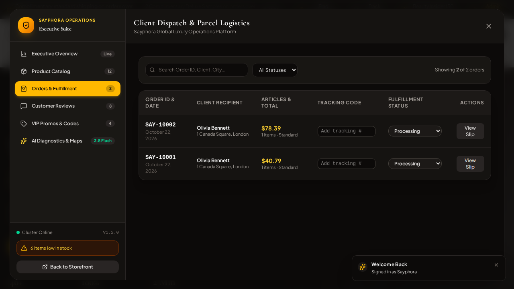</a>

After staff authentication, the fulfillment queue displays the order before a status transition is requested.

<em>Viewport: 1280 × 720</em>

</td>
<td width="50%" valign="top">
<h3>02. Order marked Packed</h3>
<a href="visuals/12-admin-order-updated.png">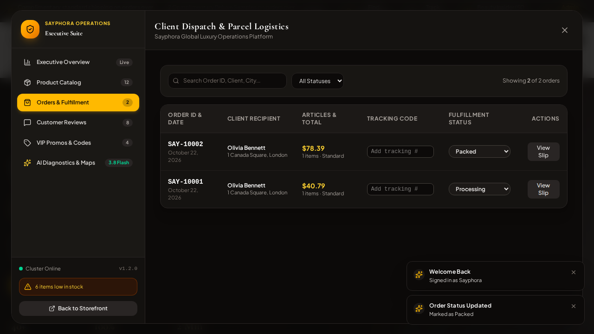</a>

The UI confirms the change, and the API confirms the persisted Packed status and the Processing → Packed event history.

<em>Viewport: 1280 × 720</em>

</td>
</tr>
</tbody>
</table>

## Wishlist

<table>
<tbody>
<tr>
<td width="50%" valign="top">
<h3>01. Saved wishlist</h3>
<a href="visuals/13-saved-wishlist.png">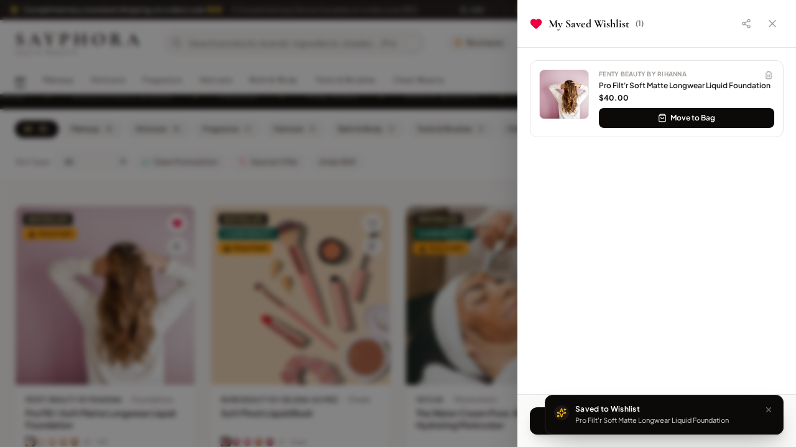</a>

A real seeded catalog product has been saved, and the wishlist drawer displays the selected item before any bag action.

<em>Viewport: 1280 × 720</em>

</td>
<td width="50%" valign="top"></td>
</tr>
</tbody>
</table>

## Product comparison

<table>
<tbody>
<tr>
<td width="50%" valign="top">
<h3>01. Side-by-side product comparison</h3>
<a href="visuals/14-product-comparison.png">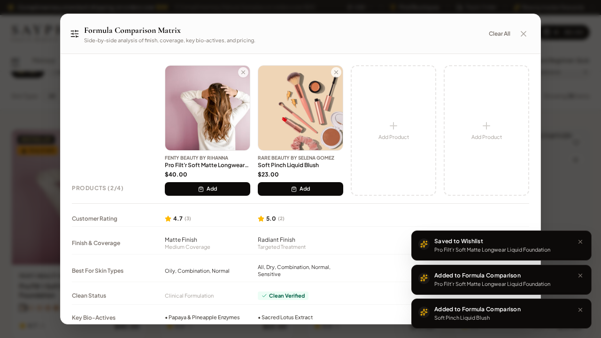</a>

Two seeded catalog products appear together in the comparison matrix, with customer rating, finish, coverage and skin-type attributes.

<em>Viewport: 1280 × 720</em>

</td>
<td width="50%" valign="top"></td>
</tr>
</tbody>
</table>

## Virtual try-on

<table>
<tbody>
<tr>
<td width="50%" valign="top">
<h3>01. Virtual try-on studio</h3>
<a href="visuals/15-virtual-try-on.png">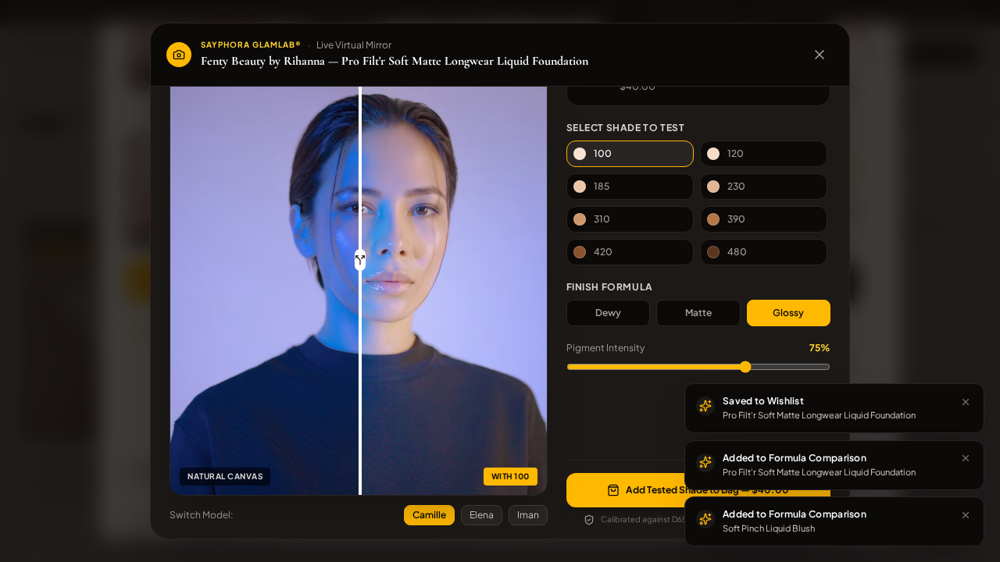</a>

The virtual mirror opens for a real foundation from the seeded catalog. The finish control is changed before the screenshot is captured.

<em>Viewport: 1280 × 720</em>

</td>
<td width="50%" valign="top">
<h3>02. Try-on shade added to the bag</h3>
<a href="visuals/16-vto-shade-added-to-bag.png">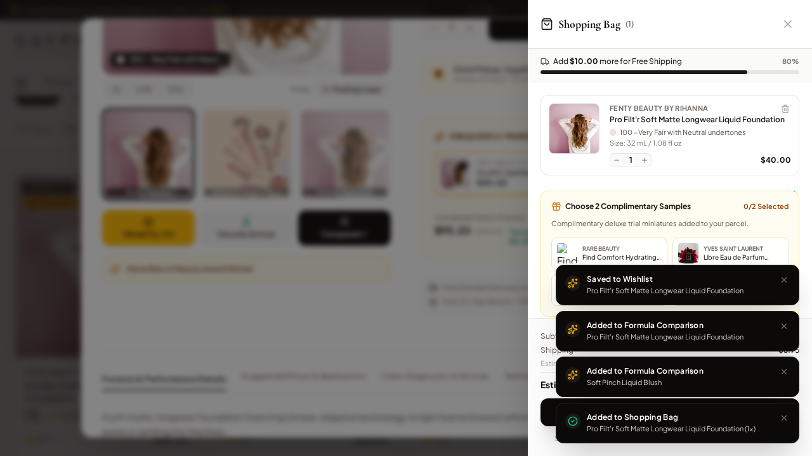</a>

After adding the selected finish, the shopping bag opens with the same seeded foundation. This confirms the mirror action reaches the cart drawer.

<em>Viewport: 1280 × 720</em>

</td>
</tr>
</tbody>
</table>

## Ingredient diagnostics

<table>
<tbody>
<tr>
<td width="50%" valign="top">
<h3>01. Ingredient safety diagnostic</h3>
<a href="visuals/17-ingredient-diagnostics.png">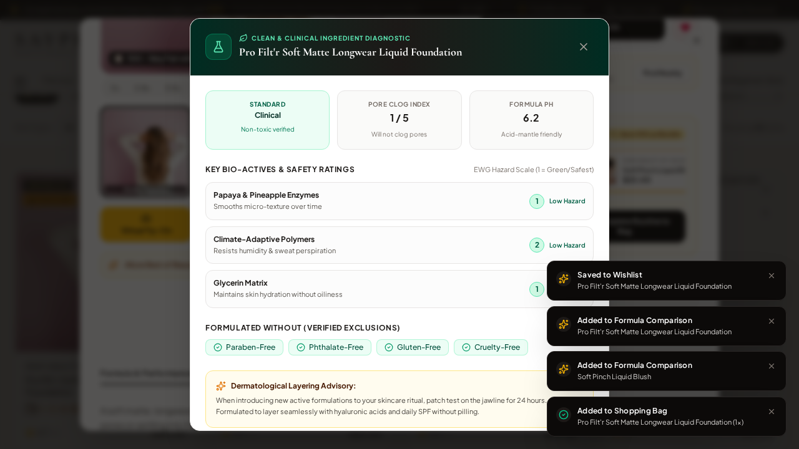</a>

The product diagnostic displays its standard, pore-clog index, formula pH and ingredient safety information for the selected catalog product.

<em>Viewport: 1280 × 720</em>

</td>
<td width="50%" valign="top"></td>
</tr>
</tbody>
</table>

## Beauty personalisation

<table>
<tbody>
<tr>
<td width="50%" valign="top">
<h3>01. Personalised shade match</h3>
<a href="visuals/18-shade-match.png">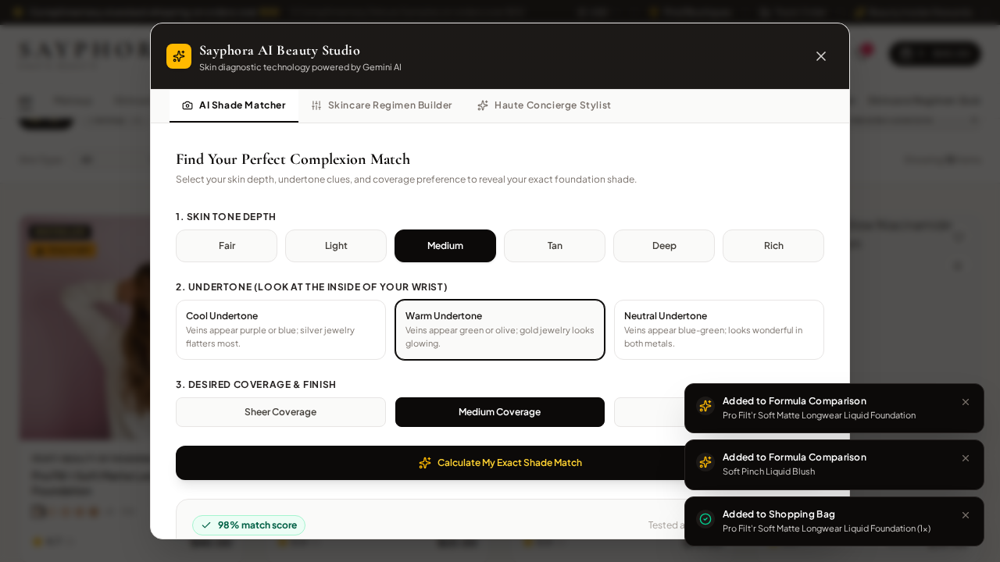</a>

The deterministic catalog-backed matcher returns an in-stock shade for the selected medium depth and warm undertone; this is not a live Gemini-provider test.

<em>Viewport: 1280 × 720</em>

</td>
<td width="50%" valign="top">
<h3>02. Morning and evening routine</h3>
<a href="visuals/19-skincare-routine.png">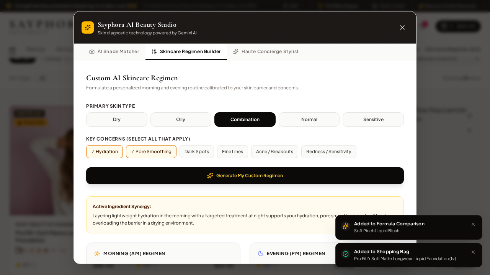</a>

The deterministic routine builder recommends real catalog products in separate AM and PM steps. Live external AI generation remains a separate integration check.

<em>Viewport: 1280 × 720</em>

</td>
</tr>
</tbody>
</table>

## Boutique locator

<table>
<tbody>
<tr>
<td width="50%" valign="top">
<h3>01. Boutique directory</h3>

The locator displays the seeded boutique directory using the built-in fallback path; no GPS permission is requested.

<em>Viewport: 1280 × 720</em>

</td>
<td width="50%" valign="top">
<h3>02. Pickup location selected</h3>
<a href="visuals/21-pickup-store-selected.png">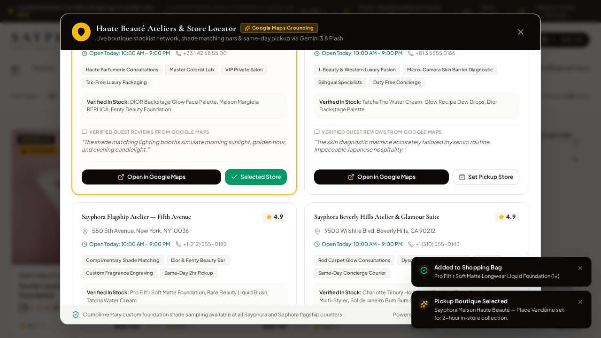</a>

The selected boutique is visibly marked in the locator after the user chooses it as the preferred pickup location.

<em>Viewport: 1280 × 720</em>

</td>
</tr>
</tbody>
</table>

---

**Verification note:** The screenshot shows the browser UI at a successful checkpoint. Backend assertions separately verify account ownership, the stored order, server-calculated totals, verified-purchase reviews and persisted fulfilment status. A screenshot alone is not used as proof of those server-side behaviors.
